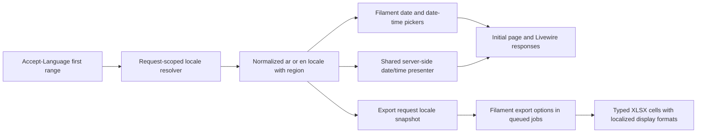

# Application-wide Date and Time Experience Redesign

* **Author:** ukbingoopaysafe
* **Status:** Revised after EGM review; awaiting owner approval
* **Date:** 2026-11-08

## Overview

Cible's existing appointment, follow-up, activity, and record dates use 24-hour time in several parts of the CRM. This design proposes one consistent date/time experience across existing pickers, displays, reports, and exports. Browser locale controls date/time content only: Arabic or unsupported locales use Arabic date/time presentation, while English uses English date/time presentation; the CRM itself remains Arabic RTL. Gregorian dates, Western numerals, 12-hour time, and `Africa/Cairo` timezone behavior remain in place.

## The Problem

Cible staff report that 24-hour time makes appointment and follow-up scheduling less convenient and can cause confusion. Date/time selection and display also use inconsistent presentation across existing CRM surfaces. This feedback is stakeholder-reported; its frequency and error rate have not been measured.

## Goals

* Use the first `Accept-Language` range to select date/time presentation: `ar` or `ar-*` for Arabic, `en` or `en-*` for English, and Arabic fallback for other or invalid first ranges. Ignore quality weights and later ranges.
* Use regional date ordering while keeping dates Gregorian and numerals Western. Display zero-padded 12-hour times with `ص` / `م` in Arabic and `AM` / `PM` in English.
* Keep the CRM interface, labels, and surrounding layout Arabic RTL while localizing date/time values and picker internals, with correct bidirectional ordering.
* Apply consistent behavior to every existing date/time-bearing control, display, report, and export, including queued exports that retain the locale chosen when the user requests them.
* Keep exported date/time values typed and useful in Excel, with display formats matching the captured locale.
* Preserve `Africa/Cairo` rendering, database storage, API contracts, backend representations, parsing, validation, and business behavior.
* Meet WCAG AA contrast, visible keyboard focus, keyboard and screen-reader operation, and responsive layout requirements in the light Cible theme.

## Date/Time Picker UX and Visual Direction

The calendar shows a clear month heading, weekday labels, previous/next navigation, and distinct selected, current, unavailable, and focused dates. Date and time selection remain one task, and changing one value preserves the others. The time control exposes a 1–12 hour selector, a 00–59 minute selector, and a two-choice AM/PM control; the selected period stays visible beside the hour and minutes.

Use Cible's gold and deep green accents on light surfaces. Keep dates and time controls readable in the Arabic RTL CRM shell, isolate localized values so Western numerals and period indicators appear in the requested order, and keep the calendar and controls visible at narrow widths. Keyboard and screen-reader users receive the same selection and navigation cues, with WCAG AA contrast and visible focus.

## Non-Goals

* Add an application language switch or translate CRM content.
* Add new date/time-bearing screens or report surfaces.
* Change database schema, stored values, APIs, timezone behavior, backend date/time representations, validation, permissions, or workflows.
* Add a third-party date/time picker dependency. The selected approach uses Filament's calendar and state handling with a first-party embedded-view override for the unsupported AM/PM interaction.

## Technical Plan

### Architecture

Use a request-scoped locale resolver as the only source of date/time presentation locale. For each full-page or Livewire request, it reads only the first comma-separated `Accept-Language` range, ignores its `q` weight, strips parameters, normalizes casing and `_`/`-`, and maps `ar` / `ar-*` to Arabic and `en` / `en-*` to English. An empty, malformed, or unsupported first range falls back to Arabic; later ranges never replace it. Keep Laravel's global `app.locale` Arabic.

The resolver retains the normalized regional tag for date ordering and export formatting, and exposes a picker bundle key of exactly `ar` or `en` because the installed Filament picker maps those base keys. Bare `ar` and `en` use ICU/CLDR likely subtags for deterministic regional defaults. `ext-intl` is a required runtime extension in every environment. The shared presenter adds Gregorian-calendar and Latin-numbering Unicode locale extensions (`u-ca-gregory-nu-latn`) and uses `IntlDateFormatter`; date-only output uses the locale's medium date style, while time uses zero-padded `hh:mm a` regardless of the region's usual clock. Instants use `Africa/Cairo`; date-only values remain calendar dates and are never shifted by a timezone.

### Request and component behavior

Add a `DateTimeLocale` resolver/context and a `DateTimePresenter` under `app/Support/`, and register both as Laravel scoped services in `AppServiceProvider`. The locale context contains the normalized presentation language (`ar` or `en`), retained regional tag, and picker bundle key. Resolve it from each current full-page or Livewire request; do not cache locale in a session, user preference, global Carbon setting, or Laravel application locale. Picker configuration and display callbacks evaluate the scoped context at render time.

Configure Filament `DatePicker` and `DateTimePicker` centrally with `native(false)`, the `ar` / `en` picker bundle key, and a regional date-display pattern. The installed picker has a published embedded-view override at `filament-forms::components.date-time-picker`; create `resources/views/vendor/filament-forms/components/date-time-picker.blade.php` from the installed version and change only its non-native time row. Keep Filament's calendar and Alpine date-time state handling, replace its 0–23 hour input and 0–59 minute input with an hour selector (1–12), minute selector (00–59), and an accessible two-choice AM/PM control. These controls update the existing Alpine `hour` value (0–23): 12 AM maps to 0, 12 PM to 12, 1–11 AM map unchanged, and 1–11 PM add 12. The field continues to submit `Y-m-d` or `Y-m-d H:i`; no locale-specific string is parsed or stored. This is a first-party Filament view customization, not a new picker package. Confirm the override path and Alpine state against the pinned vendor source during implementation and on every Filament upgrade.

Route existing date/time text through the same presenter instead of retaining scattered `dateTime()` formats or direct Carbon `format()` calls. Its API is `formatDate(DateTimeInterface|string|null $value): string`, `formatTime(DateTimeInterface|string|null $value): string`, `formatDateTime(DateTimeInterface|string|null $value): string`, `formatRelativeDateTime(DateTimeInterface|string|null $value, DateTimeInterface $referenceAt): string`, `getFilamentDatePattern(): string`, and `getFilamentDateTimePattern(): string`; null returns `''`. String inputs are limited to the existing canonical `Y-m-d` and `Y-m-d H:i[:s]` forms; picker controls do not parse localized free text. Date-only output uses `IntlDateFormatter::MEDIUM`; time uses `hh:mm a` with Western digits; date-time joins those outputs with ` · `. Relative date-time uses Cairo calendar-day boundaries: same day displays localized “Today” / `اليوم` plus the time, the previous or next calendar day displays “Yesterday” / `أمس` or “Tomorrow” / `غدًا` plus the time, and all other dates use absolute date-time output. CRM status labels such as “overdue” remain Arabic; only date/time content is localized. Invalid values are not silently normalized or saved; existing validation remains authoritative.

Keep Arabic labels and the Arabic RTL page shell. Isolate formatted values in picker internals, Filament tables, details, option labels, and Blade history views. Reuse the existing `.bidi-isolate` and `[dir="ltr"]` CSS hooks, adding only the component-specific direction needed to keep Western digits, punctuation, and `ص` / `م` or `AM` / `PM` in the intended order. Preserve machine-readable `<time datetime>` values where present.

The picker styling stays within Cible's light interface and gold/deep-green identity. Style the shared Filament view override and controls through the existing theme; do not duplicate the calendar implementation or add a third-party picker.

### Exports

The current customer and request export actions are XLSX-only. At export request time, store the normalized regional tag under the single Filament option key `cible_datetime_locale`. The installed Filament dispatcher passes options to preparation, row-chunk, and XLSX creation jobs, so chunks and retries use the request snapshot even without a browser request. No schema change is needed.

The installed Filament XLSX path reads temporary CSV rows as strings. Before CSV writing, each mapped export value therefore has a canonical machine representation: `Y-m-d` for date-only values and `Y-m-d H:i:s` in `Africa/Cairo` for timestamps. In the current four XLSX exporters, the typed timestamp allowlist is `created_at` for both customer exporters and `next_follow_up_at`, `closed_at`, and `created_at` for both request exporters; no date-only column is currently exported. During XLSX creation, override Filament `Exporter::makeXlsxRow(array $values, ?Style $style = null)` in the shared exporter concern. Use the export's selected column map to associate positional row values with column names, parse only allowlisted values as `DateTimeImmutable` in Cairo, and pass per-column OpenSpout styles to `Row::fromValuesWithStyles()`. Date-only values become date serials at midnight without timezone conversion; timestamps retain their Cairo wall time. Nulls remain empty. All other cells and Arabic column headings remain unchanged.

The shared spreadsheet format catalog derives regional date order from the normalized locale and uses explicit Excel locale-qualified number formats. Representative codes are `[$-0409]mmm d, yyyy hh:mm AM/PM` (`en-US`), `[$-0809]d mmm yyyy hh:mm AM/PM` (`en-GB`), and `[$-0C01]d mmmm yyyy hh:mm AM/PM` (`ar-EG`); time-only formats use `hh:mm AM/PM` with the same locale qualifier. Map `en-GB` to LCID `0809`, `ar-EG` to `0C01`, and all other English/Arabic regional tags to language defaults `0409` / `0C01`; always derive date token order from the full regional tag using ICU. Assert Arabic `ص` / `م` and English `AM` / `PM` in the target spreadsheet clients.

Required display targets are Microsoft Excel for Microsoft 365 on Windows (Current Channel) and Excel for the web (current production release); record the exact build and app locale in release evidence. Run an interoperability check in the current stable LibreOffice Calc for typed numeric values and date ordering. If a required target fails to display the captured locale's format, block release and repair the number format; never silently stringify a typed cell. If a downstream consumer cannot render a supported format, retain the typed value and propose a separate localized display column for owner approval before changing the workbook shape. Microsoft documents custom date/time tokens and typed date formatting in [Excel custom number formats](https://support.microsoft.com/en-us/excel/review-guidelines-for-customizing-a-number-format). The project's locked OpenSpout v4.28.5 exposes `Row::fromValuesWithStyles()` in its [installed row implementation](https://github.com/openspout/openspout/blob/v4.28.5/src/Common/Entity/Row.php).

### Existing code touchpoints

* **Shared policy and registration:** add `app/Support/DateTimeLocale.php` and `app/Support/DateTimePresenter.php`; register request-scoped resolution in `app/Providers/AppServiceProvider.php`.
* **Picker view:** create `resources/views/vendor/filament-forms/components/date-time-picker.blade.php` as the installed Filament embedded-view override for the custom 12-hour controls.
* **Picker and record surfaces:** `app/Filament/Support/SectionRequestResource.php`, `RequestFormSchema.php`, `CustomerResource.php`, and `CustomerFollowUpResource.php`; update the existing table/detail date displays in `app/Filament/Resources/Staff/StaffResource.php`, `RentalAreas/RentalAreaResource.php`, `ResaleAreas/ResaleAreaResource.php`, `Areas/AreaResource.php`, `ContactChangeRequests/ContactChangeRequestResource.php`, `app/Filament/Support/AuditEventResource.php`, `BrokerResource.php`, and `LeadSourceResource.php`.
* **History and related record views:** `resources/views/filament/modals/contact-activity-history.blade.php`, `customer-follow-up-history.blade.php`, `customer-requests.blade.php`, and `request-property-history.blade.php`.
* **Exports:** `app/Exports/Concerns/FormatsSpreadsheetData.php`, `app/Exports/Support/SpreadsheetDateTimeFormat.php`, `RentalCustomerExporter.php`, `ResaleCustomerExporter.php`, `RentalRequestExporter.php`, and `ResaleRequestExporter.php`; add the locale snapshot to the export actions in `CustomerResource.php` and `SectionRequestResource.php`.

`OperationalRequestsOverview` currently uses date windows for filtering but does not render date values; its business logic should remain unchanged. During implementation, repeat a repository-wide inventory for date/time fields, formatting calls, report output, and export actions to catch any usages outside this list before calling coverage complete.

### Verification plan

* Assert first-range locale resolution, an unchanged Arabic Laravel locale, and consistent initial-page/Livewire behavior.
* Assert the specified Gregorian/Latin-digit output, regional date order, exact 12-hour markers, relative-date boundaries, noon/midnight state mapping, and unchanged canonical state formats.
* Assert audit before/after timestamps and all Filament/Blade date-time output use bidi isolation.
* Assert queued XLSX chunks and retries retain the locale snapshot and produce typed cells with the correct Cairo values and locale-qualified formats.
* Manual interaction, accessibility, responsive, and spreadsheet-client checks are specified once in the Detailed Verification Plan.

## Alternatives Considered

| Approach | Mechanism and trade-offs | Decision and failure condition |
|---|---|---|
| **Request `Accept-Language` header** | Resolve the first header entry independently for each HTTP request. The browser supplies it on initial navigation and Livewire requests; the export action snapshots the normalized result into Filament's queued options. This keeps server-rendered content and queued exports aligned without changing the Arabic application locale. | **Selected.** Missing, invalid, or unsupported first entries intentionally fall back to Arabic; later entries are ignored. A proxy or client that omits the header therefore receives the defined Arabic fallback. |
| Client-side `navigator.languages` / `Intl` only | Let JavaScript format dates and initialize picker labels from the browser. This can react to client locale data directly, but server-rendered tables and details can initially disagree, Livewire would need client synchronization, and a queue worker cannot read the browser locale without a separate snapshot channel. | Not selected. It fails the consistency goal when initial server HTML, subsequent Livewire output, or queued exports lack the same client locale. |
| Persisted per-user locale preference | Store a date/time locale on the user's CRM profile or session and reuse it across requests and jobs. This provides a stable choice across devices, but adds persistent preference state and can diverge from the browser locale that is required to drive formatting automatically. | Not selected. It fails the stated behavior when a user's browser locale changes or a shared workstation is used by staff with different browser preferences. |
| Filament's bundled picker | Keep Filament's calendar, state binding, validation, and Alpine date handling. Customize its published embedded view only for the time row because its built-in hour input is 0–23 and has no AM/PM control. This avoids a new dependency but requires a view-compatibility check on Filament upgrades. | **Selected:** bundled calendar with a first-party AM/PM view override. A third-party picker is not needed. |
| Centralized date/time formatting | Route existing date/time output through one request-scoped locale policy and presenter. This supports consistent locale rules and coverage; the shared API must support date-only, date-time, and relative output. Per-screen formatting can be quicker locally but risks drift and missed surfaces. | **Selected:** centralized policy and presenter. |
| Typed Excel date/time cells | Store date/time as typed spreadsheet values and attach a locale-qualified display format. This preserves sorting and calculations; the trade-off is writer and client compatibility validation. Localized text renders directly but behaves as text and impairs date operations. | **Selected:** typed cells with localized display formats. If a supported client fails, block release; never replace the typed value with localized text silently. |

## Risks and Mitigations

| Risk | Mitigation |
|---|---|
| `Accept-Language` is absent, malformed, or rewritten by an intermediary, so the browser preference is unavailable to the server. | Apply Arabic fallback to the first range deterministically; test an invalid first range followed by a valid later range and confirm the later range is ignored. |
| PHP Intl/ICU locale data is missing or differs between environments. | Require `ext-intl` in Composer and every deployment image; test the same locale examples in local, CI, and production-like PHP environments. |
| The Filament embedded-view override or Alpine state changes during an upgrade. | Keep the override limited to the time row, pin the installed Filament version, and add a feature test that verifies view rendering, locale labels, canonical state mapping, and inherited min/max behavior on every upgrade. |
| A 12-hour selection could map noon or midnight to the wrong canonical hour. | Test every conversion boundary (`12 AM → 00`, `12 PM → 12`, `1–11 AM → 01–11`, `1–11 PM → 13–23`) in the custom control and submitted state. |
| Date/time strings inside the Arabic RTL shell can appear in the wrong token order, clip, or be announced unclearly. | Reuse `.bidi-isolate` and `[dir="ltr"]`; test picker, table, detail, option, and Blade output for both locale modes and run the documented keyboard/screen-reader/contrast checks. |
| Date-only values can shift as instants, or instants can use device/worker timezones. | Keep date-only values as calendar dates; use `Africa/Cairo` for instants and test timezone boundaries independently of device and queue-worker zones. |
| XLSX chunks/retries can lose locale, or a spreadsheet client can ignore the requested number format. | Persist `cible_datetime_locale` in export options; test chunks and retries. Validate the required Excel clients and block release if a typed value or localized format is wrong. |
| A date/time surface outside the inventory can retain a hard-coded format. | Repeat a repository-wide date/time inventory during implementation and verify every discovered control, display, report, and export uses the shared policy. |

## Detailed Implementation Plan

### Target Files to Create/Modify

#### Locale policy and picker configuration

1. `composer.json` (**Modify**)
   * **Type / Scope**: PHP runtime requirements.
   * **Proposed Changes**: Declare `ext-intl` as a required PHP extension because locale normalization and `IntlDateFormatter` are part of the selected design. This makes missing support fail during environment setup instead of silently changing output.
2. `composer.lock` (**Modify**)
   * **Type / Scope**: Composer lock metadata.
   * **Proposed Changes**: Refresh the root platform requirement metadata after updating `composer.json`; do not update unrelated package versions.
3. `app/Support/DateTimeLocale.php` (**Create**)
   * **Type / Scope**: Request-scoped locale value and resolver.
   * **Proposed Changes**: Read only the first comma-separated `Accept-Language` range, strip its `q` parameter, normalize the tag, map `ar-*` to Arabic and `en-*` to English, and map all other or invalid values to Arabic. Preserve a recognized region and expand bare `ar` / `en` with ICU likely subtags. Expose the presentation locale and direction without changing Laravel's app locale.
4. `app/Support/DateTimePresenter.php` (**Create**)
   * **Type / Scope**: Shared date/time presentation service.
   * **Proposed Changes**: Implement `formatDate()`, `formatTime()`, `formatDateTime()`, `formatRelativeDateTime()`, `getFilamentDatePattern()`, and `getFilamentDateTimePattern()`. Use `IntlDateFormatter::MEDIUM` for regional Gregorian date order, Latin digits, fixed `hh:mm a` for 12-hour time, ` · ` as the date-time separator, and `Africa/Cairo` for instants. Relative output uses Cairo calendar days: today, yesterday, and tomorrow get localized date words plus the time; other dates use absolute date-time output. Null returns empty; invalid values are not silently changed. Date-only values remain calendar dates.
5. `app/Providers/AppServiceProvider.php` (**Modify**)
   * **Type / Scope**: Application service registration and shared Filament defaults.
   * **Proposed Changes**: Register the locale and presenter as scoped services. Configure both Filament picker types centrally with `native(false)`, the base picker locale (`ar` or `en`), regional date pattern, and `Africa/Cairo` for instants. Keep the Laravel application locale Arabic.
6. `resources/css/filament/admin/theme.css` (**Modify**)
   * **Type / Scope**: Existing Filament admin theme.
   * **Proposed Changes**: Style the calendar and time controls with Cible's light, gold, and deep-green tokens. Reuse existing `.bidi-isolate` and `[dir="ltr"]` hooks; add only missing picker direction rules, visible focus, and responsive popover sizing. Keep the Arabic RTL page shell.
7. `resources/views/vendor/filament-forms/components/date-time-picker.blade.php` (**Create**)
   * **Type / Scope**: Filament's published embedded-view override, whose lookup path is declared by the installed `DateTimePicker` component.
   * **Proposed Changes**: Copy the embedded view from the installed Filament version and replace only the non-native 0–23 hour and numeric minute inputs. Render an hour selector for 1–12, a minute selector for 00–59, and accessible AM/PM radio-style buttons; map their choices into the existing Alpine `hour` value (0–23). Preserve Filament calendar navigation, state binding, validation, disabled state, bounds, and canonical `Y-m-d H:i` state. Keep the override diff small and review it on every Filament upgrade.

#### Existing Filament input and display surfaces

Use the shared picker defaults for all existing date and date-time inputs. Replace local date/time formatting and option labels with the shared presenter in these files:

8. `app/Filament/Support/SectionRequestResource.php` (**Modify**) — local date/time formatting appears in follow-up and viewing actions, selection labels, detail placeholders, table displays, and the request XLSX export action; use the presenter and snapshot export locale here.
9. `app/Filament/Support/RequestFormSchema.php` (**Modify**) — route custom follow-up formatting and date/time detail entries through the shared presenter.
10. `app/Filament/Support/CustomerResource.php` (**Modify**) — route date/time table, activity, deal-option, and detail values through the presenter; snapshot locale on customer XLSX export.
11. `app/Filament/Support/CustomerFollowUpResource.php` (**Modify**) — replace hard-coded overdue/today/absolute date strings and date-time detail output with presenter calls.
12. `app/Filament/Support/AuditEventResource.php` (**Modify**) — localize the event timestamp and allowlisted date/time values nested in before/after payloads, including `next_follow_up_at`, while preserving sortable underlying state and leaving non-date values unchanged.
13. `app/Filament/Support/BrokerResource.php` (**Modify**) — localize date/time table and detail output.
14. `app/Filament/Support/LeadSourceResource.php` (**Modify**) — localize its relative update-time display without changing Arabic field labels.
15. `app/Filament/Resources/Staff/StaffResource.php` (**Modify**) — localize the staff creation timestamp.
16. `app/Filament/Resources/RentalAreas/RentalAreaResource.php` (**Modify**) — localize the area creation timestamp.
17. `app/Filament/Resources/ResaleAreas/ResaleAreaResource.php` (**Modify**) — localize the area creation timestamp.
18. `app/Filament/Resources/Areas/AreaResource.php` (**Modify**) — localize the area creation timestamp.
19. `app/Filament/Resources/ContactChangeRequests/ContactChangeRequestResource.php` (**Modify**) — localize the contact-change request timestamp.

Update the date/time values and direction markup in these history and related-record views:

20. `resources/views/filament/modals/contact-activity-history.blade.php` (**Modify**) — use localized display text and retain the machine-readable `datetime` value.
21. `resources/views/filament/modals/customer-follow-up-history.blade.php` (**Modify**) — present follow-up and activity timestamps with bidi isolation.
22. `resources/views/filament/modals/customer-requests.blade.php` (**Modify**) — localize request creation and next-follow-up values.
23. `resources/views/filament/modals/request-property-history.blade.php` (**Modify**) — localize inspection and viewing timestamps.

#### XLSX output

24. `app/Exports/Concerns/FormatsSpreadsheetData.php` (**Modify**)
   * **Type / Scope**: Shared Filament exporter concern.
   * **Proposed Changes**: Define the typed timestamp allowlist by exporter and column name; encode only those values in temporary CSV as `Y-m-d H:i:s` Cairo strings; override `makeXlsxRow()`; use the persisted selected-column order to map row positions; rehydrate mapped timestamps as `DateTimeImmutable`; and call OpenSpout `Row::fromValuesWithStyles()` with per-column styles. Leave unmapped and null values unchanged.
25. `app/Exports/Support/SpreadsheetDateTimeFormat.php` (**Create**) — map normalized `ar-*` / `en-*` locales to supported Excel locale identifiers and generate/test regional date plus localized 12-hour number-format codes.
26. `app/Exports/RentalCustomerExporter.php` (**Modify**) — mark `created_at` as a typed timestamp column.
27. `app/Exports/ResaleCustomerExporter.php` (**Modify**) — mark `created_at` as a typed timestamp column.
28. `app/Exports/RentalRequestExporter.php` (**Modify**) — mark `next_follow_up_at`, `closed_at`, and `created_at` as typed timestamp columns.
29. `app/Exports/ResaleRequestExporter.php` (**Modify**) — mark `next_follow_up_at`, `closed_at`, and `created_at` as typed timestamp columns.

The export action options closure is available through Filament's `CanExportRecords::options()` API. Store the normalized locale tag under `cible_datetime_locale` in the customer and request export actions; the installed dispatcher forwards it to preparation, row-chunk, and XLSX jobs. Use the exporter column map to identify selected row positions by `ExportColumn` name. Current types: customer `created_at` is DateTime; request `next_follow_up_at`, `closed_at`, and `created_at` are DateTime; the current four exporters contain no date-only columns. If the inventory finds one, encode it as `Y-m-d` and rehydrate it as a calendar date at Excel serial midnight with no timezone conversion. Keep workbook headings Arabic. Do not change `CustomerSpreadsheetImportService`, whose representation is import/storage behavior.

#### Automated tests

30. `tests/Unit/DateTimeLocaleTest.php` (**Create**) — cover first-range parsing regardless of `q`, region retention, `ar` / `en` likely subtags, base picker keys, invalid/missing/unsupported first ranges, and Arabic fallback.
31. `tests/Unit/DateTimePresenterTest.php` (**Create**) — cover the examples `en-US: Nov 4, 2026 / 05:30 PM`, `en-GB: 4 Nov 2026 / 05:30 PM`, `ar-EG: 4 نوفمبر 2026 / 05:30 م`, Gregorian/Western digits, relative day boundaries, null/invalid values, and Cairo timezone boundaries.
32. `tests/Unit/SpreadsheetDateTimeFormatTest.php` (**Create**) — assert Excel locale IDs and exact date/time format codes for `en-US`, `en-GB`, and `ar-EG`, plus `en-AU` / `ar-MA` base-language LCID fallback with date-token ordering derived from each full regional tag.
33. `tests/Feature/FilamentDateTimeLocalizationTest.php` (**Create**) — render date-only and combined controls under Arabic, English, and unsupported headers; assert `native(false)`, picker base-key mapping, 12-hour controls, localized labels, bidi isolation, accessibility labels, and unchanged `Y-m-d` / `Y-m-d H:i` state. Test `12 AM`, `12 PM`, and both sides of noon.
34. `tests/Feature/DateTimeExportLocalizationTest.php` (**Create**) — assert locale snapshot options persist across preparation, chunks, and retries; all listed timestamp columns remain numeric date/time cells with matching locale-qualified formats and accurate Cairo values; and Arabic column headings remain unchanged.

No browser automation framework is present in the repository. Do not add a test dependency for this change. `OperationalRequestsOverview` uses dates for query windows only and remains unchanged. `CustomerSpreadsheetImportService` remains unchanged to preserve its import representation.

### Implementation order

1. Require `ext-intl`; implement and test the request-scoped locale and presenter.
2. Register `native(false)` picker defaults and the bundled base locale; add the minimal embedded-view override and verify the 12-hour mapping against Filament's existing Alpine state.
3. Route inventoried displays, audit payloads, options, and history views through the presenter; use existing bidi hooks and repeat the repository-wide inventory.
4. Capture `cible_datetime_locale`; implement the named `makeXlsxRow()` conversion, typed-column map, and locale-qualified number formats.
5. Complete the detailed verification plan. Preserve database/API values, timezone behavior, Arabic CRM labels, import parsing, validation, and business rules.

### Verification Plan

* **Runtime/build:** confirm `ext-intl` is enabled in local, CI, and production images; Composer must fail when it is missing. Check the embedded-view override against the installed Filament package source.
* **Locale and presenter:** run unit tests for first-range parsing and the exact `en-US`, `en-GB`, `ar-EG`, and unsupported-first examples; verify Arabic global app locale, Gregorian dates, Western numerals, null handling, and Cairo boundaries.
* **Picker state and accessibility:** assert `00:00 → 12:00 AM`, `12:00 → 12:00 PM`, `01:00 → 01:00 AM`, and `13:30 → 01:30 PM`, with equivalent Arabic markers. Confirm the submitted state remains `Y-m-d H:i`, the date remains `Y-m-d`, and existing min/max, required, disabled, and validation behavior remains active.
* **Coverage and bidi:** verify date/time values in forms, tables, details, filters, dashboards, reports, export headings/data, audit before/after payloads, and history views. Check isolated values in RTL context and ensure surrounding CRM labels stay Arabic.
* **XLSX:** inspect workbooks generated in Arabic and English requests after multiple chunks and a retry. Assert typed Excel date serials, per-cell number-format codes, captured locale, accurate Cairo instants, stable date-only values, Arabic headings, and `ص` / `م` or `AM` / `PM` in Excel 365 desktop and Excel for the web. Record exact app builds/settings; run a typed-value interoperability check in current stable LibreOffice Calc. A format failure blocks release.
* **Manual UX/accessibility:** test Arabic and English date/time locales in the Arabic RTL shell at 360, 390, 768, 1024, 1280, and 1440 CSS-pixel widths. Verify month/day labels, previous/next navigation, date selection, time selection, focus visibility, keyboard operation, screen-reader labels for hour/minute/period, WCAG AA contrast, and no clipping or horizontal overflow.
