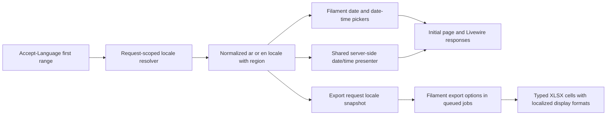

# Application-wide Date and Time Experience Redesign

* **Author:** ukbingoopaysafe
* **Status:** Draft
* **Date:** 2026-11-08

## Overview

Cible's existing appointment, follow-up, activity, and record dates use 24-hour time in several parts of the CRM. This design proposes one consistent date/time experience across existing pickers, displays, reports, and exports. Browser locale controls date/time content only: Arabic or unsupported locales use Arabic date/time presentation, while English uses English date/time presentation; the CRM itself remains Arabic RTL. Gregorian dates, Western numerals, 12-hour time, and `Africa/Cairo` timezone behavior remain in place.

## The Problem

Cible staff report that 24-hour time makes appointment and follow-up scheduling less convenient and can cause confusion. Date/time selection and display also use inconsistent presentation across existing CRM surfaces. This feedback is stakeholder-reported; its frequency and error rate have not been measured.

## Goals

* Use the browser's primary preferred locale to select date/time presentation: `ar` or `ar-*` for Arabic, `en` or `en-*` for English, and Arabic fallback for other or invalid primary locales.
* Use regional date ordering while keeping dates Gregorian and numerals Western. Display zero-padded 12-hour times with `ص` / `م` in Arabic and `AM` / `PM` in English.
* Keep the CRM interface, labels, and surrounding layout Arabic RTL while localizing date/time values and picker internals, with correct bidirectional ordering.
* Apply consistent behavior to every existing date/time-bearing control, display, report, and export, including queued exports that retain the locale chosen when the user requests them.
* Keep exported date/time values typed and useful in Excel, with display formats matching the captured locale.
* Preserve `Africa/Cairo` rendering, database storage, API contracts, backend representations, parsing, validation, and business behavior.
* Meet WCAG AA contrast, visible keyboard focus, keyboard and screen-reader operation, and responsive layout requirements in the light Cible theme.

## Date/Time Picker UX and Visual Direction

The calendar and time-selection experience should feel distinctive, elegant, modern, and effortless within Cible's familiar light interface. Clear hierarchy and calm spacing should make the current month, available dates, selected value, and navigation easy to understand at a glance. Choosing a time should make the hour, minutes, and AM/PM period unambiguous; combining a date and time should feel like one coherent task and preserve the user's choices while they adjust them.

Use Cible's gold and deep green as restrained, recognizable accents against light surfaces, with readable text and clear selected, current, unavailable, and focus states. The visual treatment should feel polished without competing with the scheduling task. Arabic and English date/time content must remain easy to scan in the Arabic RTL CRM shell, with numerals and AM/PM indicators in the intended order. At narrow widths, the calendar and time controls should remain fully visible and usable. Keyboard and screen-reader users should receive the same clear selection and navigation cues as visual users, with WCAG AA contrast and visible focus.

## Non-Goals

* Add an application language switch or translate CRM content.
* Add new date/time-bearing screens or report surfaces.
* Change database schema, stored values, APIs, timezone behavior, backend date/time representations, validation, permissions, or workflows.
* Replace the installed date/time picker or add a new picker dependency unless the technical plan demonstrates that the current Filament picker cannot meet the stated requirements.

## Technical Plan

### Architecture

Use a request-scoped locale resolver as the only source of date/time presentation locale. The resolver reads the first range in the current request's `Accept-Language` header, normalizes it, applies the approved Arabic/English mapping, and falls back to Arabic for a missing, invalid, or unsupported first range. It does not inspect later ranges. Keep Laravel's global `app.locale` as Arabic.

The resolver will preserve a recognized regional tag (for example `en-GB` or `ar-EG`) for regional date ordering. It will take the first comma-separated range regardless of quality weights, remove its optional `q` parameter, normalize casing and `_`/`-`, and never promote a later language. A bare `ar` or `en` will be expanded using ICU/CLDR likely-subtag defaults so its date order is deterministic. The presenter will use PHP Intl/`IntlDateFormatter`, force the Gregorian calendar and Latin digits (`0–9`), and use a zero-padded 12-hour pattern even for English regions that conventionally use 24-hour time. The local PHP runtime has `ext-intl`; deployment availability must be verified and declared as an explicit runtime requirement if this formatter is selected. Cairo remains the display timezone for instants, and date-only values remain civil dates without timezone conversion.

### Request and component behavior

Add a small `DateTimeLocale` resolver/context and a `DateTimePresenter` under `app/Support/`, and register the resolver as a Laravel scoped service in `AppServiceProvider`. Resolve from the current request on every full-page and Livewire request; do not cache locale in a session, user preference, global Carbon setting, or Laravel application locale. Picker configuration and display callbacks must evaluate the scoped context at render time.

Configure Filament `DatePicker` and `DateTimePicker` centrally so existing fields receive the detected locale, locale-specific date ordering and labels, 12-hour time selection, and the localized AM/PM choices. Keep the existing picker implementation and state formats (`Y-m-d` / `Y-m-d H:i`) unless a focused compatibility check shows a Filament limitation. Use a shared adapter for the ICU date pattern and the pattern expected by Filament's bundled picker; do not let presentation patterns alter the submitted state. The repository currently has combined `DateTimePicker` fields and a `DatePicker`, with no standalone `TimePicker` usage.

Route existing date/time text through the same presenter instead of retaining scattered `dateTime()` formats or direct Carbon `format()` calls. Keep Arabic labels and the Arabic RTL page shell. Set direction on the date/time component internals according to their localized content, and isolate formatted values with bidi-safe markup so digits, punctuation, and `ص` / `م` or `AM` / `PM` stay in the intended order. Preserve machine-readable `<time datetime>` values where present. Relative date/time text should be localized as date/time content without changing the language of surrounding CRM labels.

The picker styling should stay within Cible's light interface and gold/deep-green identity. Prefer shared theme hooks around the installed Filament picker; introduce a custom shared wrapper only if the installed component cannot meet the interaction and visual acceptance criteria.

### Exports

The current customer and request export actions are XLSX-only. At export request time, add the normalized locale (including its region) to the Filament export options payload. Filament passes that payload to the preparation job, row-chunk jobs, and XLSX creation job, so all chunks and retries use the original locale even when a worker has no browser request or its deployment locale differs. No schema change is needed for this snapshot.

Preserve date/time data as machine-readable Cairo values in Filament's temporary export rows. The installed XLSX path reads those temporary CSV rows as strings, so it will not retain typed date values automatically. Extend the shared exporter row-conversion seam to rehydrate known date/time columns as `DateTimeInterface` values and apply per-cell OpenSpout number formats using the captured locale. Date/time cells remain Excel date serials, not localized text; the number format supplies the localized display. Keep export column headings in Arabic because they are CRM labels. Verify the Arabic AM/PM number format in supported spreadsheet applications before considering the export path complete.

### Existing code touchpoints

* **Shared policy and registration:** add `app/Support/DateTimeLocale.php` and `app/Support/DateTimePresenter.php`; register request-scoped resolution in `app/Providers/AppServiceProvider.php`.
* **Picker and record surfaces:** `app/Filament/Support/SectionRequestResource.php`, `RequestFormSchema.php`, `CustomerResource.php`, and `CustomerFollowUpResource.php`; update the existing table/detail date displays in `app/Filament/Resources/Staff/StaffResource.php`, `RentalAreas/RentalAreaResource.php`, `ResaleAreas/ResaleAreaResource.php`, `Areas/AreaResource.php`, `ContactChangeRequests/ContactChangeRequestResource.php`, `app/Filament/Support/AuditEventResource.php`, `BrokerResource.php`, and `LeadSourceResource.php`.
* **History and related record views:** `resources/views/filament/modals/contact-activity-history.blade.php`, `customer-follow-up-history.blade.php`, `customer-requests.blade.php`, and `request-property-history.blade.php`.
* **Exports:** `app/Exports/Concerns/FormatsSpreadsheetData.php`, `RentalCustomerExporter.php`, `ResaleCustomerExporter.php`, `RentalRequestExporter.php`, and `ResaleRequestExporter.php`; add the locale snapshot to the export actions in `CustomerResource.php` and `SectionRequestResource.php`.

`OperationalRequestsOverview` currently uses date windows for filtering but does not render date values; its business logic should remain unchanged. During implementation, repeat a repository-wide inventory for date/time fields, formatting calls, report output, and export actions to catch any usages outside this list before calling coverage complete.

### Verification plan

* Unit-test locale parsing for `ar`, regional Arabic, `en`, regional English, unsupported first entries, malformed/missing headers, and headers with additional preferred locales. Confirm the first entry alone determines the result and that Laravel's global locale remains Arabic.
* Test date/time presentation with Gregorian dates, Western numerals, region-specific date order, fixed 12-hour time, Arabic `ص` / `م`, English `AM` / `PM`, noon, midnight, date-only values, and Cairo timezone boundaries.
* Feature-test initial Filament rendering and Livewire requests with Arabic, English, and unsupported `Accept-Language` headers, including bidi ordering and unchanged submitted state values.
* Exercise queued XLSX exports with locale changes after dispatch, multiple chunks, and a retry. Inspect the resulting workbook to confirm date/time cells are typed and have the captured locale's number format while their stored Cairo values remain accurate.
* Manually review picker navigation, selection, focus visibility, keyboard operation, screen-reader labels, contrast, and clipping at 360, 390, 768, 1024, 1280, and 1440 CSS-pixel widths in Arabic RTL and English date/time locale modes. Check the Arabic AM/PM format in the supported spreadsheet applications.

## Alternatives Considered

| Approach | Mechanism and trade-offs | Decision and failure condition |
|---|---|---|
| **Request `Accept-Language` header** | Resolve the first header entry independently for each HTTP request. The browser supplies it on initial navigation and Livewire requests; the export action snapshots the normalized result into Filament's queued options. This keeps server-rendered content and queued exports aligned without changing the Arabic application locale. | **Selected.** Missing, invalid, or unsupported first entries intentionally fall back to Arabic; later entries are ignored. A proxy or client that omits the header therefore receives the defined Arabic fallback. |
| Client-side `navigator.languages` / `Intl` only | Let JavaScript format dates and initialize picker labels from the browser. This can react to client locale data directly, but server-rendered tables and details can initially disagree, Livewire would need client synchronization, and a queue worker cannot read the browser locale without a separate snapshot channel. | Not selected. It fails the consistency goal when initial server HTML, subsequent Livewire output, or queued exports lack the same client locale. |
| Persisted per-user locale preference | Store a date/time locale on the user's CRM profile or session and reuse it across requests and jobs. This provides a stable choice across devices, but adds persistent preference state and can diverge from the browser locale that is required to drive formatting automatically. | Not selected. It fails the stated behavior when a user's browser locale changes or a shared workstation is used by staff with different browser preferences. |
| Filament's bundled picker | Reuse and centrally theme the installed picker. This keeps existing Filament form state and interactions integrated; the trade-off is working within its available styling and localization hooks. A separate package or bespoke picker allows more control but adds dependency, integration, accessibility, and maintenance work. | **Preferred:** reuse Filament. Consider a separate/custom picker only if a focused compatibility review shows the bundled component cannot meet the approved UX and accessibility criteria. |
| Centralized date/time formatting | Route existing date/time output through one shared policy and formatter. This supports consistent locale rules and coverage; the trade-off is that the shared API must support date-only, date-time, and contextual displays. Per-screen formatting can be quicker locally but risks drift and missed surfaces. | **Preferred:** centralized policy and presenter. Individual formatting is acceptable only for non-date/time content; duplicating date/time rules would fail the global consistency goal. |
| Typed Excel date/time cells | Store date/time as typed spreadsheet values and attach a locale-specific display format. This preserves spreadsheet sorting and calculations; the trade-off is writer-format compatibility and validation across spreadsheet applications. Localized text values are simpler to render exactly but behave as text and are less useful for calculations and date operations. | **Preferred:** typed cells with localized display formats. Use localized text only if a target spreadsheet application cannot reliably render the required format, and retain a typed-value path wherever compatibility permits. |

## Risks and Mitigations

| Risk | Mitigation |
|---|---|
| `Accept-Language` is absent, malformed, or rewritten by an intermediary, so the user's apparent browser preference is unavailable to the server. | Apply the agreed Arabic fallback deterministically and test first-entry parsing, including invalid first entries followed by valid secondary entries. |
| PHP Intl/ICU locale data or the bundled Filament picker may not produce the required regional date order, 12-hour interaction, Arabic day-period markers, or Western digits consistently. | Verify `ext-intl` and supported locale data in deployment, then run locale-specific formatter and picker checks against the installed Filament version before broad rollout. |
| English date/time content inside the Arabic RTL shell can display in the wrong token order, clip at narrow widths, or be announced unclearly to assistive technology. | Apply component-level direction and bidi isolation; verify keyboard and screen-reader behavior, WCAG AA contrast, and the specified viewport widths in both locale modes. |
| A date-only value can shift when treated as a timezone-bearing instant, or a timestamp can render using the device or queue worker timezone instead of Cairo. | Keep date-only values as civil dates and explicitly use `Africa/Cairo` for instants; cover both with boundary tests independent of device timezone. |
| Queued exports may lose the request locale on retries or chunks, and the Filament CSV intermediate may turn date values into text before XLSX writing. | Snapshot locale in export options and rehydrate only allowlisted date/time columns as typed cells; test multi-chunk/retry cases and inspect cell types and localized formats in supported spreadsheet applications. |
| A date/time surface outside the initial inventory can retain a hard-coded format and make the experience inconsistent. | Repeat repository-wide searches for date/time fields, formatter calls, reports, and export actions during implementation, then verify each discovered surface uses the shared policy. |

## Detailed Implementation Plan

### Target Files to Create/Modify

#### Locale policy and picker configuration

1. `composer.json` (**Modify**)
   * **Type / Scope**: PHP runtime requirements.
   * **Proposed Changes**: Declare `ext-intl` as a required PHP extension because locale normalization and `IntlDateFormatter` are part of the selected design. This makes missing support fail during environment setup instead of silently changing output.
2. `composer.lock` (**Modify**)
   * **Type / Scope**: Composer lock metadata.
   * **Proposed Changes**: Refresh the root platform requirement metadata after updating `composer.json`; do not update unrelated package versions.
3. `app/Support/DateTimeLocale.php` (**Create**)
   * **Type / Scope**: Request-scoped locale value and resolver.
   * **Proposed Changes**: Read only the first comma-separated `Accept-Language` range, strip its `q` parameter, normalize the tag, map `ar-*` to Arabic and `en-*` to English, and map all other or invalid values to Arabic. Preserve a recognized region and expand bare `ar` / `en` with ICU likely subtags. Expose the presentation locale and direction without changing Laravel's app locale.
4. `app/Support/DateTimePresenter.php` (**Create**)
   * **Type / Scope**: Shared date/time presentation service.
   * **Proposed Changes**: Provide date-only, time-only, date-time, and relative date/time formatting. Use Gregorian calendar data, Latin digits, locale-specific date ordering, fixed zero-padded 12-hour time, Arabic `ص` / `م` or English `AM` / `PM`, and `Africa/Cairo` for instants. Treat date-only values as civil dates. Cache formatter instances within the request-scoped service.
5. `app/Providers/AppServiceProvider.php` (**Modify**)
   * **Type / Scope**: Application service registration and shared Filament defaults.
   * **Proposed Changes**: Register the locale and presenter as scoped services. Configure Filament `DatePicker` and `DateTimePicker` defaults centrally for locale, regional display pattern, 12-hour time, and Cairo timezone. Leave `App::setLocale()` and the global Arabic application locale untouched.
6. `resources/css/filament/admin/theme.css` (**Modify**)
   * **Type / Scope**: Existing Filament admin theme.
   * **Proposed Changes**: Style the shared calendar and time selection controls with Cible's light, gold, and deep-green tokens. Add component-level direction and bidi isolation, visible focus treatment, and responsive popover sizing without changing the Arabic RTL page shell.

#### Existing Filament input and display surfaces

Use the shared picker defaults for all existing date and date-time inputs. Replace local date/time formatting and option labels with the shared presenter in these files:

7. `app/Filament/Support/SectionRequestResource.php` (**Modify**) — local date/time formatting appears in follow-up and viewing actions, selection labels, detail placeholders, table displays, and the request XLSX export action; use the presenter and snapshot export locale here.
8. `app/Filament/Support/RequestFormSchema.php` (**Modify**) — route custom follow-up formatting and date/time detail entries through the shared presenter.
9. `app/Filament/Support/CustomerResource.php` (**Modify**) — route date/time table, activity, deal-option, and detail values through the presenter; snapshot locale on customer XLSX export.
10. `app/Filament/Support/CustomerFollowUpResource.php` (**Modify**) — replace hard-coded overdue/today/absolute date strings and date-time detail output with presenter calls.
11. `app/Filament/Support/AuditEventResource.php` (**Modify**) — localize audit timestamps while preserving sortable underlying state.
12. `app/Filament/Support/BrokerResource.php` (**Modify**) — localize date/time table and detail output.
13. `app/Filament/Support/LeadSourceResource.php` (**Modify**) — localize its relative update-time display without changing Arabic field labels.
14. `app/Filament/Resources/Staff/StaffResource.php` (**Modify**) — localize the staff creation timestamp.
15. `app/Filament/Resources/RentalAreas/RentalAreaResource.php` (**Modify**) — localize the area creation timestamp.
16. `app/Filament/Resources/ResaleAreas/ResaleAreaResource.php` (**Modify**) — localize the area creation timestamp.
17. `app/Filament/Resources/Areas/AreaResource.php` (**Modify**) — localize the area creation timestamp.
18. `app/Filament/Resources/ContactChangeRequests/ContactChangeRequestResource.php` (**Modify**) — localize the contact-change request timestamp.

Update the date/time values and direction markup in these history and related-record views:

19. `resources/views/filament/modals/contact-activity-history.blade.php` (**Modify**) — use localized display text and retain the machine-readable `datetime` value.
20. `resources/views/filament/modals/customer-follow-up-history.blade.php` (**Modify**) — present follow-up and activity timestamps with bidi isolation.
21. `resources/views/filament/modals/customer-requests.blade.php` (**Modify**) — localize request creation and next-follow-up values.
22. `resources/views/filament/modals/request-property-history.blade.php` (**Modify**) — localize inspection and viewing timestamps.

#### XLSX output

23. `app/Exports/Concerns/FormatsSpreadsheetData.php` (**Modify**)
   * **Type / Scope**: Shared Filament exporter concern.
   * **Proposed Changes**: Add the shared date/time column map, preserve invariant machine-readable values in temporary rows, and implement the XLSX row-conversion hook to rehydrate only mapped date/time cells as typed values with per-cell OpenSpout formats based on the captured locale.
24. `app/Exports/RentalCustomerExporter.php` (**Modify**) — identify the customer creation date column for typed XLSX conversion.
25. `app/Exports/ResaleCustomerExporter.php` (**Modify**) — identify the customer creation date column for typed XLSX conversion.
26. `app/Exports/RentalRequestExporter.php` (**Modify**) — identify request follow-up, closure, and creation date/time columns for typed XLSX conversion.
27. `app/Exports/ResaleRequestExporter.php` (**Modify**) — identify request follow-up, closure, and creation date/time columns for typed XLSX conversion.

The export action options closure is available through Filament's `CanExportRecords::options()` API. Store the normalized locale and region under one namespaced option key in `CustomerResource.php` and `SectionRequestResource.php`; Filament already forwards options to preparation, row-chunk, and XLSX jobs. Keep workbook column headings Arabic. Do not change `app/Services/CustomerSpreadsheetImportService.php`, whose date formatting is an import/storage representation rather than UI presentation.

#### Automated tests

28. `tests/Unit/DateTimeLocaleTest.php` (**Create**) — cover first-entry parsing, `q` stripping without reordering, valid Arabic and English region tags, bare-language defaults, invalid/missing values, and Arabic fallback.
29. `tests/Unit/DateTimePresenterTest.php` (**Create**) — cover Gregorian date ordering, Western digits, exact AM/PM markers, 12-hour zero-padding, noon/midnight, date-only stability, relative values, and Cairo timezone boundaries.
30. `tests/Feature/FilamentDateTimeLocalizationTest.php` (**Create**) — render representative date and combined date-time fields and outputs under Arabic, English, and unsupported request headers; exercise a Livewire request and assert unchanged form state and Arabic global locale.
31. `tests/Feature/DateTimeExportLocalizationTest.php` (**Create**) — assert the export action snapshots the normalized locale, queued chunk/retry jobs retain it, and generated XLSX date columns are typed with the matching number format and accurate Cairo values.

No browser automation framework is present in the repository. Do not add a new test dependency for this change; perform the picker visual, keyboard, screen-reader, contrast, and viewport checks as release QA. `OperationalRequestsOverview` uses date windows for query logic only and remains unchanged. `CustomerSpreadsheetImportService` also remains unchanged to preserve its canonical import representation.

### Implementation order

1. Add and verify the `ext-intl` requirement; implement and unit-test request-scoped locale normalization and the shared presenter.
2. Register centralized Filament picker defaults and apply the shared picker theme. Verify date ordering, day/month names, 12-hour selection, AM/PM markers, Arabic RTL internals, and English LTR internals before migrating output surfaces.
3. Replace the enumerated local date/time formatters and Blade output with presenter calls; perform a second repository-wide inventory to catch any remaining UI formatter.
4. Snapshot locale through the two XLSX actions and add typed cell conversion in the shared exporter concern. Validate both regional number formats and queue retries.
5. Run the verification plan below and complete manual responsive and accessibility review. Do not change persistence, APIs, business rules, import parsing, or application language.

### Verification Plan

* **Runtime/build**: confirm `ext-intl` is present in every supported PHP environment; run `composer install` in a clean environment and `npm run build` after theme changes.
* **Automated tests**: run the four new tests individually, then `composer test` for the full Laravel suite. Run `php -l` on changed PHP files.
* **Locale and data assertions**: test first-header-entry semantics including unsupported-first/English-second; verify the Arabic application locale is unchanged; assert date-only values do not move and instants display in Cairo regardless of device timezone.
* **XLSX assertions**: generate a multi-chunk export, retry at least one job, and inspect a workbook from Arabic and English requests. Confirm cells remain numeric date/time values, display formats match the captured locale, and underlying values retain the correct Cairo wall time.
* **Browser/release QA**: test the locale-specific picker and displays in RTL and LTR content direction at 360, 390, 768, 1024, 1280, and 1440 CSS-pixel widths. Verify there is no clipping or horizontal overflow, keyboard selection and visible focus work, screen-reader labels identify selected dates and AM/PM, and contrast meets WCAG AA.
