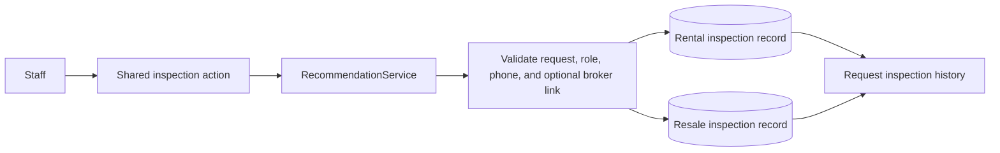

# Apartment Inspection Contact Capture

* **Author:** ukbingoopaysafe
* **Status:** Ready for implementation
* **Date:** 2026-11-10

--------------------------------------------------------------------------------

## Overview

Rental and Resale teams use the same workflow to record a unit inspection. The current inspection record captures the field representative, inspection time, photo match, defects, and notes, but it does not capture the owner or broker contact used for the unit. This design adds a required contact role, name, and phone to new inspections in both departments. The contact details remain attached to that inspection as a historical snapshot, not as a property or listing record.

When staff record a broker as the inspection contact, they may explicitly link the inspection to the broker already attached to the customer's request if it is the same person. A different broker remains unlinked. The active form will no longer collect defects; existing defect information remains available in inspection history, while notes remain available for new inspections.

## The Problem

Employees need to contact the owner to arrange access to a unit. If the owner's phone is unavailable, they need to record the broker who brought the unit and the broker's phone. The current inspection form has no place to record either contact, and its separate defects field overlaps with the inspection notes staff need to keep.

The system already has a broker attached to a customer request, but that broker may differ from the person who brought the inspected unit. Automatically using the request broker could attach the wrong person. At the same time, using only a broker profile would not preserve the exact contact details recorded during the inspection. The inspection therefore needs its own contact snapshot, with an optional explicit link only when staff confirm it is the same broker as the request's broker.

## Goals

* Label the inspection action and form **فحص الشقة** in both Rental and Resale.
* Require staff to select whether the inspection contact is the unit owner or a broker, and require that person's name and phone for every new inspection.
* Preserve the entered role, name, and phone as part of the inspection history for the lifetime of the request.
* Allow an explicit optional link to the broker already attached to that request when it is the same person; leave a different broker unlinked.
* Stop collecting defects on new inspections while keeping existing defect records visible in history; retain the notes field for new inspection notes.
* Keep the existing inspection representative, time, photo-match result, request access rules, and inspection eligibility rules.
* Apply the same behavior in both departments while retaining their separate records.

## Non-Goals

* Creating a central property, listing, unit, or owner database.
* Creating or updating a broker profile while recording an inspection.
* Matching brokers automatically by name or phone.
* Changing when a recommendation can be inspected or when a customer viewing can be scheduled.
* Removing historic defect values or changing the photo-match workflow.

## Open Questions

None.

## Critical User Journeys (CUJs)

### CUJ 1: Record an owner contact

* **Given**: An active Rental or Resale request has a recommendation eligible for inspection.
* **When**: Staff open **فحص الشقة**, choose **مالك الوحدة**, and enter the owner's name and phone with the inspection details.
* **Then**: The new inspection saves the owner's role, name, and normalized phone in its request history, with no broker link and no central owner or listing record.

### CUJ 2: Record the request broker or a different inspection broker

* **Given**: The request may have a broker attached to it.
* **When**: Staff choose **وسيط** and enter the contact's name and phone; they select **ربط بوسيط الطلب** only when that person is the same as the request's broker.
* **Then**: A selected link points to the department-specific broker staff saw and confirmed. The save is rejected if the request's broker changed before submission, so staff can reconfirm the new identity. A different broker remains an unlinked contact snapshot. If the request broker changes or is deleted after the inspection is saved, the contact snapshot remains unchanged and deletion clears only the link.

### CUJ 3: Read an older inspection

* **Given**: An inspection was recorded before contact snapshots were introduced and may contain `observed_defects`.
* **When**: An authorized employee opens request history after the change.
* **Then**: The old inspection remains readable without invented contact data, and old defects appear as **عيوب سابقة**, separate from any notes.

## Technical Plan (Architecture)

### Shared inspection flow

Keep the existing shared `recordFieldInspection` Filament action and `RecommendationService::recordInspection()` service. Change the user-facing action label and modal heading to **فحص الشقة**, while preserving the internal action key. Use one role choice in both departments: **مالك الوحدة** (`owner`) or **وسيط** (`broker`). Require **اسم جهة التواصل** and **رقم هاتف جهة التواصل** for the person staff reached. Submit `contact_role`, `contact_name`, `phone`, `phone_country`, and `link_request_broker`; when the link control is shown, also submit `shown_request_broker_id` with the broker ID staff saw so the service can verify that identity has not changed.

Build the phone input with the existing `PhoneField` country selector, defaulting to Egypt (`EG`); staff can select and confirm the correct country for the number. Validate `contact_name` as required and at most 255 characters; require the role to be exactly `owner` or `broker`; require a valid two-letter country code; and normalize `phone` plus `phone_country` with `CustomerPhoneNormalizer`. Store the normalized value in `contact_phone_e164` (at most 16 characters, including `+`) and the country in `contact_phone_country`. Do not copy or update the broker profile when staff choose a broker. Keep the phone and name as the inspection's point-in-time snapshot.

Show an unchecked **ربط بوسيط الطلب** control only when the role is broker and the Rental or Resale request already has a broker. Show that broker's identity beside the control. When staff select the control, the service must lock and re-read the request in the save transaction, compare the currently attached broker ID with the ID staff saw and confirmed, and reject the save for reconfirmation if the broker changed. Do not offer a generic broker search. For an owner contact, an unchecked control, or a request without a broker, `linked_broker_id` remains null; reject any attempt to link another broker ID.

The request form submits the selected recommendation and inspection fields to the shared service. The service keeps the existing authorization, active-request, and recommendation-status checks, validates the new required contact fields and optional broker link, and rejects service payloads containing `observed_defects`. It then creates the department-specific inspection and audit event in one transaction.

### Inspection storage and history

Add nullable role, contact name, normalized phone, and phone-country fields to both inspection tables. They remain nullable in the database so existing inspections can be read without invented contact details; the service requires them for every new inspection. Do not backfill contact details from the request's broker because that does not prove whom staff contacted.

Keep the `observed_defects` column and its existing values in both tables. Do not accept it in new service requests. Keep the notes field for new inspection notes and label it **ملاحظات الفحص**. Use **فحص الشقة** in the history heading and empty-state message; show the contact snapshot and notes on each existing inspection entry, and show old defect values there as **عيوب سابقة**, separate from notes. Keep the contact snapshot in the same history record under the existing request and department access rules. Use **فحص الشقة** as the action and form heading too.

For each new inspection audit event, include exactly `contact_role` (`owner` or `broker`), `broker_link_confirmed` (`true` or `false`), and `linked_broker_id` (the department-specific broker ID when linked, otherwise `null`). Display the role values in Arabic as **مالك الوحدة** or **وسيط**. Do not include contact name, phone number, or notes in audit metadata or application logs. Keep existing audit events readable and retain the current event key.

### Broker link persistence

Store the optional link as a nullable department-specific `linked_broker_id` foreign key on each inspection. The Rental inspection table points to `rental_brokers`; the Resale inspection table points to `resale_brokers`. Use `nullOnDelete` so deleting a broker clears only the link, while the required contact role, name, and phone snapshot remain in the request history.

The form presents the boolean **ربط بوسيط الطلب** control, not a broker picker. Apply the eligibility, identity-confirmation, transaction, and rejection rules in §Shared inspection flow. Store the confirmed department-specific broker ID in `linked_broker_id`; after the inspection is saved, later request-broker changes do not alter that link. A different inspection broker is saved only as a contact snapshot with `linked_broker_id` null.

## Alternatives Considered

### A central owner, property, listing, or unit record

* **Pros**: A central record could support reuse and search across requests.
* **Cons**: It would turn one inspection's contact into a broader property or owner data model that this workflow does not need.
* **Reason for Rejection**: Rejected by author: the owner or broker details belong in the inspection record only, not in a central Listing catalog.

### Use the broker profile instead of an inspection contact snapshot

* **Pros**: The inspection could refer to one existing broker record without copying contact details.
* **Cons**: The unit may be represented by an owner or by a different broker than the broker attached to the request. A broker profile can also change after the inspection and would not preserve who staff contacted at the time.
* **Reason for Rejection**: Rejected for this design: every inspection needs its own required role, name, and phone snapshot, even when an optional broker link is also recorded.

### Search or automatically match any broker in the department

* **Pros**: Staff could link an inspection to a broker record even when that broker is not attached to the request.
* **Cons**: Similar names or phone values could link the wrong broker, and automatic matching would create a relation the employee did not confirm.
* **Reason for Rejection**: Rejected by author: link only to the request's existing broker when staff explicitly confirm it is the same person; do not link a different broker.

### Resolve the broker link through the request whenever history is viewed

* **Pros**: This avoids a broker foreign key on each inspection.
* **Cons**: If a request's broker changes, an older inspection would appear linked to the newly assigned broker instead of the broker staff confirmed at inspection time.
* **Reason for Rejection**: Not selected after the author chose an independent broker foreign key on each inspection.

### Store the broker ID without a foreign key

* **Pros**: The numeric broker ID would remain on the inspection after the broker profile is deleted.
* **Cons**: The database could not ensure that the ID refers to a real broker, and the application would not have a normal relationship for navigation or validation.
* **Reason for Rejection**: Not selected after the author chose a department-specific foreign key with `nullOnDelete`; the contact name and phone snapshot remain if the broker link is cleared.

### Drop old defect data or merge it into notes

* **Pros**: Removing the old column or combining its content could reduce the number of fields shown in history.
* **Cons**: Dropping or merging values could erase historical information or make old defect text indistinguishable from notes staff entered at the time.
* **Reason for Rejection**: Rejected for historical safety: stop new defect entry but keep old values read-only and separate from notes.

--------------------------------------------------------------------------------

## Non-Functional Requirements

### Security and privacy

* Keep owner and broker contact snapshots in the request's inspection history permanently, under the existing request and department access rules. Do not add global contact search or a separate listing record.
* Keep contact names, phone numbers, and notes out of audit metadata and application logs. Audit role and link metadata only.
* If a broker profile is deleted, the foreign key becomes null while the inspection's contact snapshot remains.

### Rollout and rollback

* Add the new fields as nullable so historical inspection rows remain readable and no contact details are fabricated.
* Apply the additive migration before deploying the new writer. Cut over all inspection writes atomically to the new version, or temporarily disable inspection writes during the cutover; do not allow an older writer to create new inspections after contact validation takes effect.
* Require role, name, phone, and country on all new submissions at both the form and service layers. If the application is rolled back to an older writer, keep inspection writes disabled until the new writer is restored.
* Keep the migration forward-only. A `down()` attempt must abort with a clear error before dropping any contact column; application rollback leaves the expanded schema and saved snapshots in place. Operators must not roll back this data-bearing migration.
* Apply the same schema and validation rules to both departments while preserving their separate tables and broker records.

### Dependencies and performance

* Use the existing phone field and normalization service. Add no external services or packages.
* Keep the current request and department access path; no cross-department lookup is introduced.

--------------------------------------------------------------------------------

## Additional Resources

* [Concepts brief](./concepts_brief.md)
* [Decision records](../../DECISIONS.md)
* [Data model](../../DATA_MODEL.md)
* [Workflows](../../WORKFLOWS.md)
* [Acceptance tests](../../ACCEPTANCE_TESTS.md)
* `app/Filament/Support/SectionRequestResource.php`
* `app/Services/RecommendationService.php`
* `resources/views/filament/modals/request-property-history.blade.php`

--------------------------------------------------------------------------------

## Detailed Implementation Plan

Product code and product documentation will be changed on `main`. This EGM design and its review reports remain on `docs/egm-apartment-inspection`.

### Target Files to Create or Modify

| File | Change and reason |
| --- | --- |
| `database/migrations/2026_11_10_000000_add_contact_snapshots_to_section_field_inspections.php` — create | Add nullable `contact_role` (string up to 16 characters; allowed values `owner`/`broker`), `contact_name` (string up to 255 characters), `contact_phone_e164` (string up to 16 characters including `+`), `contact_phone_country` (two-letter country code), and `linked_broker_id` to both inspection tables. Match each nullable foreign key to that department's broker table with `nullOnDelete`. Do not backfill contact fields or remove `observed_defects`. Make the migration forward-only: `down()` must abort with a clear error before dropping any fields; application rollback leaves the expanded schema and snapshots in place. |
| `app/Models/RentalFieldInspection.php` — modify | Add a `BelongsTo` relationship from `linked_broker_id` to `RentalBroker`, while keeping the contact snapshot independent of broker-profile updates. |
| `app/Models/ResaleFieldInspection.php` — modify | Add the matching `BelongsTo` relationship from `linked_broker_id` to `ResaleBroker`. |
| `app/Services/RecommendationService.php` — modify | Accept `contact_role`, `contact_name`, `phone`, `phone_country`, `link_request_broker`, and `shown_request_broker_id`. Enforce the stated role/name/phone/country limits and normalize phone/country into the snapshot columns. Reject any payload containing `observed_defects`. When linking, lock and re-read the department request inside the transaction; reject if its current broker ID differs from `shown_request_broker_id`, if the role is owner, or if there is no request broker. Preserve existing authorization, active-request, and recommendation-status checks. Write only the exact audit metadata specified in §Inspection storage and history. |
| `app/Filament/Support/SectionRequestResource.php` — modify | Change the action label and modal heading to **فحص الشقة** while retaining `recordFieldInspection`. Add **مالك الوحدة** (`owner`) / **وسيط** (`broker`), required **اسم جهة التواصل**, and required **رقم هاتف جهة التواصل** using `PhoneField` with its country selector defaulted to `EG`. Add an unchecked **ربط بوسيط الطلب** control only for broker contacts when the request has a broker, and submit the displayed broker ID for confirmation. Keep the notes field; remove the defects input. Use the same form for Rental and Resale. |
| `resources/views/filament/modals/request-property-history.blade.php` — modify | Use **فحص الشقة** in the history heading and empty-state message. On each existing inspection entry, show its saved contact snapshot and notes; show old `observed_defects` values read-only as **عيوب سابقة** and distinct from notes. Show the linked broker only when the relation still exists. |
| `app/Filament/Support/AuditEventResource.php` — modify | Display the inspection event and subject as **فحص الشقة**. Add Arabic labels and values for `contact_role`, `broker_link_confirmed`, and `linked_broker_id`. Keep the old `has_observed_defects` label so existing audit events remain readable. |
| `docs/DECISIONS.md` — modify | Append a decision clarifying the narrow inspection-history exception to both `D-015` and `D-060`: owner/broker contact snapshots are allowed only on inspection records, stay with request history, and do not create a central owner or unit catalog. Preserve the original decision history. |
| `docs/PRD.md` — modify | Clarify in `PRD-042` that both departments record the inspection contact as a required snapshot, with only the optional request-broker link, and no central listing database. |
| `docs/DATA_MODEL.md` — modify | Update `D-060`'s model description with the contact snapshot fields, department-specific optional broker foreign key, nullable legacy rows, and retained defects history. Replace the previous blanket rule that inspection records contain no owner data with the narrow inspection-only exception. |
| `docs/WORKFLOWS.md` — modify | Update Rental §2.4 and Resale §3.4 to describe the same owner-or-broker choice, required contact name and phone, country selection, exact optional request-broker link rule, notes, and legacy defect display. Make clear that this does not establish a property/owner catalog. |
| `docs/ACCEPTANCE_TESTS.md` — modify | Revise AT-086 so new inspections record notes and old defects are legacy-only; add a separate read-only legacy-defect history case. Add acceptance cases for required contact data in both departments, invalid or stale broker links, retention after reassignment, form/service rejection of `observed_defects`, snapshot history, and the exact privacy-safe audit metadata. |
| `tests/Feature/RecommendationWorkflowTest.php` — modify | Update service inputs to the specified contact keys and cover both department models, field limits, valid/invalid/stale broker links, snapshot persistence, rejected `observed_defects` payloads, legacy defects retention, and exact audit metadata without personal contact values. |
| `tests/Feature/FilamentUiAccessTest.php` — modify | Update the existing form workflow and cover the new contact fields, conditional link control, renamed action/form heading, and contact/history display in Rental and Resale. |
| `tests/Feature/RequestActionsMenuStructureTest.php` — modify | Assert the user-facing label is **فحص الشقة** while the existing action key and menu placement remain unchanged in both departments. |
| `tests/Feature/InspectionSnapshotMigrationTest.php` — create | For both inspection tables, verify rollback refusal leaves the new columns, saved snapshots, and existing `observed_defects` values intact. |
| `docs/CURRENT_STATE.md` — modify after implementation | Add a dated record of the shipped behavior and the actual verification results; do not report tests as passing unless they were run and passed. |

The existing `observed_defects` column and values remain as legacy history.

### Implementation Phases and Checkpoints

1. **Schema and relationships:** Add the nullable snapshot/link columns, department-specific relationships, and forward-only migration test. Checkpoint: both schemas and relationships are valid; the migration test proves rollback refusal preserves snapshot and legacy defect values.
2. **Service contract:** Implement required field validation, country-aware phone normalization, locked broker confirmation, `observed_defects` rejection, and the exact audit payload. Checkpoint: `RecommendationWorkflowTest` passes for required fields, both departments, invalid/stale links, rejection of defects input, retention, and audit privacy.
3. **Shared form and history:** Update the shared action, both department workflows, history entries, and audit display. Checkpoint: inspection-specific `FilamentUiAccessTest` cases and `RequestActionsMenuStructureTest` pass; verify Rental and Resale entry/empty states.
4. **Product documentation:** Update both decision boundaries, PRD, data model, Rental §2.4, Resale §3.4, acceptance criteria including AT-086, and the known test baseline. Checkpoint: all documentation agrees on the exception, rollout, field contract, and retained legacy defects.
5. **Final verification and record:** Run the focused checks below, inspect both department histories and audit events, then update `CURRENT_STATE.md` with actual results. Checkpoint: all new inspection-specific tests pass and no result is reported as passing unless it was run and passed.

### Verification Plan

* Run `php artisan test --filter=RecommendationWorkflowTest`.
* Run `php artisan test --filter=InspectionSnapshotMigrationTest`.
* Add dedicated Rental and Resale inspection-flow methods in `FilamentUiAccessTest` and run those methods by their exact test names. `CURRENT_STATE.md` records 18 failures in the last full test run, including two broker-entry failures in that file; distinguish those known failures from the new inspection-specific results and do not report the whole file as passing while they remain.
* Run `php artisan test --filter=RequestActionsMenuStructureTest`.
* Inspect both Rental and Resale request histories for the new contact snapshot, the correct linked broker, legacy defect text, and notes.
* Confirm the audit event contains role/link metadata but no contact name, phone, or notes.
* Confirm migration rollback aborts clearly and does not remove contact columns or saved snapshots after data has been stored.

--------------------------------------------------------------------------------

<!-- Provenance: Initial structural drafting via EGM. -->

*Drafted with EGM*
