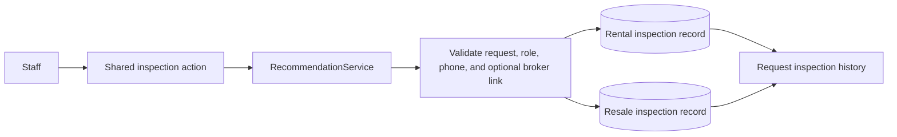

# Apartment Inspection Contact Capture

* **Author:** ukbingoopaysafe
* **Status:** Draft
* **Date:** 2026-11-10

## Overview

Rental and Resale teams use the same workflow to record a unit inspection. The current inspection record captures the field representative, inspection time, photo match, defects, and notes, but it does not capture the owner or broker contact used for the unit. This design adds a required contact role, name, and phone to new inspections in both departments. The contact details remain attached to that inspection as a historical snapshot, not as a property or listing record.

When staff record a broker as the inspection contact, they may explicitly link the inspection to the broker already attached to the customer's request if it is the same person. A different broker remains unlinked. The active form will no longer collect defects; existing defect information remains available in inspection history, while notes remain available for new inspections.

## The Problem

Employees need to contact the owner to arrange access to a unit. If the owner's phone is unavailable, they need to record the broker who brought the unit and the broker's phone. The current inspection form has no place to record either contact, and its separate defects field overlaps with the inspection notes staff need to keep.

The system already has a broker attached to a customer request, but that broker may differ from the person who brought the inspected unit. Automatically using the request broker could attach the wrong person. At the same time, using only a broker profile would not preserve the exact contact details recorded during the inspection. The inspection therefore needs its own contact snapshot, with an optional explicit link only when staff confirm it is the same broker as the request's broker.

## Goals

* Label the inspection action and form **فحص الشقة** in both Rental and Resale.
* Require staff to select whether the inspection contact is the unit owner or a broker, and require that person's name and phone for every new inspection.
* Preserve the entered role, name, and phone as part of the inspection history for the lifetime of the request.
* Allow an explicit optional link to the broker already attached to that request when it is the same person; leave a different broker unlinked.
* Stop collecting defects on new inspections while keeping existing defect records visible in history; retain the notes field for new inspection notes.
* Keep the existing inspection representative, time, photo-match result, request access rules, and inspection eligibility rules.
* Apply the same behavior in both departments while retaining their separate records.

## Non-Goals

* Creating a central property, listing, unit, or owner database.
* Creating or updating a broker profile while recording an inspection.
* Matching brokers automatically by name or phone.
* Changing when a recommendation can be inspected or when a customer viewing can be scheduled.
* Removing historic defect values or changing the photo-match workflow.

## Technical Plan (Architecture)

### Shared inspection flow

Keep the existing shared `recordFieldInspection` Filament action and `RecommendationService::recordInspection()` service. Change the user-facing action label and modal heading to **فحص الشقة**, while preserving the internal action key. Use one owner/broker role choice in both departments. The selected role controls whether the optional broker-link control is available; staff always enter the name and phone of the person they reached.

Build the phone input with the existing `PhoneField` and validate and normalize it with `CustomerPhoneNormalizer`. Store the normalized E.164 number and country alongside the contact name and role. Do not copy or update the broker profile when staff choose a broker. Keep the phone and name as the inspection's point-in-time snapshot.

Show an unchecked **ربط بوسيط الطلب** control only when the role is broker and the request already has a broker. Show the request's broker identity beside the control. If selected, the service must verify that the selected link is exactly the broker attached to the request belonging to the selected recommendation and the current department. Do not offer a generic broker search. For an owner contact, a different broker, or a request without a broker, the link remains empty.

The request form submits the selected recommendation and inspection fields to the shared service. The service keeps the existing active-request and recommendation-status checks, validates the new required contact fields and any optional broker link, then creates the department-specific inspection and audit event in one transaction.

### Inspection storage and history

Add nullable role, contact name, normalized phone, and phone-country fields to both inspection tables. They remain nullable in the database so existing inspections can be read without invented contact details; the service requires them for every new inspection. Do not backfill contact details from the request's broker because that does not prove whom staff contacted.

Keep `observed_defects` and its existing values in both tables. Remove it from new form submissions and service validation, but show saved values read-only in request history as **عيوب سابقة**. Keep the notes field for new inspection notes and label it **ملاحظات الفحص**. Show the contact snapshot in the same history record under the existing request and department access rules. Use **فحص الشقة** as the history heading as well as the action and form heading.

The audit event may include the contact role, whether the optional link was selected, and the linked broker ID. It must not include the contact name, phone number, or notes. Keep existing audit events readable and retain the current event key.

### Broker link persistence

Store the optional link as a nullable department-specific `linked_broker_id` foreign key on each inspection. The Rental inspection table points to `rental_brokers`; the Resale inspection table points to `resale_brokers`. Use `nullOnDelete` so deleting a broker clears only the link, while the required contact role, name, and phone snapshot remain in the request history.

The form presents a boolean **ربط بوسيط الطلب** control, not a broker picker or broker ID field. When staff select it, the service copies the broker ID from the request attached to the selected recommendation into `linked_broker_id`. The service must reject the selection if the contact role is owner, the request has no broker, or the relationship is not the request's broker in the current department. When the request's broker changes later, the inspection link stays with the broker that staff linked at inspection time. A different inspection broker is saved only as a contact snapshot, with `linked_broker_id` left null.

## Alternatives Considered

### A central owner, property, listing, or unit record

* **Pros**: A central record could support reuse and search across requests.
* **Cons**: It would turn one inspection's contact into a broader property or owner data model that this workflow does not need.
* **Reason for Rejection**: Rejected by author: the owner or broker details belong in the inspection record only, not in a central Listing catalog.

### Use the broker profile instead of an inspection contact snapshot

* **Pros**: The inspection could refer to one existing broker record without copying contact details.
* **Cons**: The unit may be represented by an owner or by a different broker than the broker attached to the request. A broker profile can also change after the inspection and would not preserve who staff contacted at the time.
* **Reason for Rejection**: Rejected for this design: every inspection needs its own required role, name, and phone snapshot, even when an optional broker link is also recorded.

### Search or automatically match any broker in the department

* **Pros**: Staff could link an inspection to a broker record even when that broker is not attached to the request.
* **Cons**: Similar names or phone values could link the wrong broker, and automatic matching would create a relation the employee did not confirm.
* **Reason for Rejection**: Rejected by author: link only to the request's existing broker when staff explicitly confirm it is the same person; do not link a different broker.

### Resolve the broker link through the request whenever history is viewed

* **Pros**: This avoids a broker foreign key on each inspection.
* **Cons**: If a request's broker changes, an older inspection would appear linked to the newly assigned broker instead of the broker staff confirmed at inspection time.
* **Reason for Rejection**: Not selected after the author chose an independent broker foreign key on each inspection.

### Store the broker ID without a foreign key

* **Pros**: The numeric broker ID would remain on the inspection after the broker profile is deleted.
* **Cons**: The database could not ensure that the ID refers to a real broker, and the application would not have a normal relationship for navigation or validation.
* **Reason for Rejection**: Not selected after the author chose a department-specific foreign key with `nullOnDelete`; the contact name and phone snapshot remain if the broker link is cleared.

### Drop old defect data or merge it into notes

* **Pros**: Removing the old column or combining its content could reduce the number of fields shown in history.
* **Cons**: Dropping or merging values could erase historical information or make old defect text indistinguishable from notes staff entered at the time.
* **Reason for Rejection**: Rejected for historical safety: stop new defect entry but keep old values read-only and separate from notes.

## Detailed Implementation Plan

Product code and product documentation will be changed on `main`. This EGM design and its review reports remain on `docs/egm-apartment-inspection`.

### Target Files to Create or Modify

| File | Change and reason |
| --- | --- |
| `database/migrations/2026_11_10_000000_add_contact_snapshots_to_section_field_inspections.php` — create | Add nullable `contact_role`, `contact_name`, `contact_phone_e164`, `contact_phone_country`, and `linked_broker_id` to both `rental_field_inspections` and `resale_field_inspections`. Point each nullable foreign key to that department's broker table with `nullOnDelete`. Do not backfill contact fields or drop `observed_defects`. Make the migration forward-only: `down()` must refuse to drop the new fields because contact snapshots are permanent request history. |
| `app/Models/RentalFieldInspection.php` — modify | Add a `BelongsTo` relationship from `linked_broker_id` to `RentalBroker`, while keeping the contact snapshot independent of broker-profile updates. |
| `app/Models/ResaleFieldInspection.php` — modify | Add the matching `BelongsTo` relationship from `linked_broker_id` to `ResaleBroker`. |
| `app/Services/RecommendationService.php` — modify | Require role (`owner` or `broker`), contact name, phone, and country for new inspections. Normalize the phone to E.164. Remove `observed_defects` from new validation and persistence. When the explicit link flag is true, set `linked_broker_id` from the request attached to the recommendation and reject owner contacts or requests without a broker. Keep the existing authorization, active-request, and recommendation-status checks. Record role and link metadata in the audit event, never contact name, phone, or notes. |
| `app/Filament/Support/SectionRequestResource.php` — modify | Change the action label and modal heading to **فحص الشقة** while retaining `recordFieldInspection`. Add the role choice, required name and reusable `PhoneField`, an unchecked link control shown only for broker contacts when the request has a broker, and the existing notes field. Remove the defects input. Use the same form for Rental and Resale. |
| `resources/views/filament/modals/request-property-history.blade.php` — modify | Show **فحص الشقة** in the history heading and empty state, along with the saved contact snapshot and inspection notes. Display old `observed_defects` values read-only as **عيوب سابقة** so they remain distinct from notes. Show the linked broker only when the relation still exists. |
| `app/Filament/Support/AuditEventResource.php` — modify | Display the inspection event and subject as **فحص الشقة**. Add Arabic labels for role and broker-link metadata. Keep the old `has_observed_defects` label so existing audit events remain readable. |
| `docs/DECISIONS.md` — modify | Add a new decision that narrows the old `D-060` rule: inspection-scoped owner/broker contact snapshots are allowed, remain with request history, and do not create a central owner or unit catalog. Preserve the original decision history. |
| `docs/PRD.md` — modify | Clarify in `PRD-042` that both departments record the inspection contact as a required snapshot, with only the optional request-broker link, and no central listing database. |
| `docs/DATA_MODEL.md` — modify | Update `D-060`'s model description with the contact snapshot fields, department-specific optional broker foreign key, nullable legacy rows, and retained defects history. Replace the previous blanket rule that inspection records contain no owner data with the narrow inspection-only exception. |
| `docs/WORKFLOWS.md` — modify | Update Rental inspection steps and Resale unit/contact guidance to describe owner-or-broker selection, required name and phone, the exact optional link rule, notes, and legacy defect display. Make clear that this does not establish a property/owner catalog. |
| `docs/ACCEPTANCE_TESTS.md` — modify | Add acceptance cases for required contact data in both departments, exact broker-link validation and retention after request reassignment, history display of snapshots and old defects, removal of new defects entry, and audit exclusion of personal contact data. |
| `tests/Feature/RecommendationWorkflowTest.php` — modify | Update service inputs to include required contact data and cover both department models, valid and invalid broker links, snapshot persistence, legacy defects retention, and audit metadata without personal contact values. |
| `tests/Feature/FilamentUiAccessTest.php` — modify | Update the existing form workflow and cover the new contact fields, conditional link control, renamed action/form heading, and contact/history display in Rental and Resale. |
| `tests/Feature/RequestActionsMenuStructureTest.php` — modify | Assert the user-facing label is **فحص الشقة** while the existing action key and menu placement remain unchanged in both departments. |
| `docs/CURRENT_STATE.md` — modify after implementation | Add a dated record of the shipped behavior and the actual verification results; do not report tests as passing unless they were run and passed. |

No source file or database column will be deleted. The existing `observed_defects` column remains as legacy history.

### Critical User Journeys

#### CUJ 1: Record an owner contact

* **Given**: An active Rental or Resale request has a recommendation eligible for inspection.
* **When**: Staff open **فحص الشقة**, choose **مالك الوحدة**, and enter the owner's name and phone with the inspection details.
* **Then**: The new inspection saves the owner's role, name, and normalized phone in its request history, with no broker link and no central owner or listing record.

#### CUJ 2: Record the request broker or a different inspection broker

* **Given**: The request may have a broker attached to it.
* **When**: Staff choose **وسيط** and enter the contact's name and phone; they select **ربط بوسيط الطلب** only when that person is the same as the request's broker.
* **Then**: A selected link points to that department's request broker as it existed at inspection time. A different broker remains an unlinked contact snapshot. If the request broker later changes or is deleted, the inspection's saved contact details remain unchanged.

#### CUJ 3: Read an older inspection

* **Given**: An inspection was recorded before contact snapshots were introduced and may contain `observed_defects`.
* **When**: An authorized employee opens request history after the change.
* **Then**: The old inspection remains readable without invented contact data, and old defects appear as **عيوب سابقة**, separate from any notes.

### Verification Plan

* Run `php artisan test --filter=RecommendationWorkflowTest`.
* Run `php artisan test --filter=FilamentUiAccessTest`.
* Run `php artisan test --filter=RequestActionsMenuStructureTest`.
* Inspect both Rental and Resale request histories for the new contact snapshot, the correct linked broker, legacy defect text, and notes.
* Confirm the audit event contains role/link metadata but no contact name, phone, or notes.
* Confirm rollback does not remove data-bearing contact columns after snapshots have been stored.
