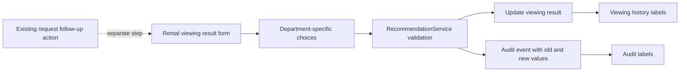

# Rental Viewing Result Statuses

* **Author:** ukbingoopaysafe
* **Status:** In Progress
* **Date:** 2026-11-10

## Overview

Rental employees need viewing results that match the outcomes they record in their daily work. This change gives them five result choices for each rental viewing while keeping the resale team's current choices in place until that team is consulted. A result records what happened at the viewing; it does not schedule another viewing, close the request, or create a deal.

## The Problem

The current rental viewing form offers general outcomes such as “interested,” “not interested,” “wants another viewing,” “started negotiation,” and “cancelled.” Rental employees have agreed on a different set that distinguishes a customer reservation, an unsuitable unit, interest in viewing another apartment, a completed rental, and a pending customer reply.

The current structured list cannot represent the agreed rental outcomes consistently. The list must distinguish a customer reserving a unit from completing its rental, and it must preserve the reason when a unit is marked unsuitable.

## Goals

* Show exactly these five choices when recording a rental viewing result: `حجز`, `غير مناسبة`, `يرغب بمعاينة شقة أخرى`, `تم التأجير`, and `انتظار الرد`.
* Define `حجز` as the customer for the request reserving the unit associated with the viewing.
* Define `تم التأجير` as completing the rental of the unit associated with that viewing for the customer represented by the request. If the customer is not yet known, the request must be linked to a known broker and the result stays attached to that request.
* Allow `حجز` and `تم التأجير` only when the viewing links to a recommendation belonging to the request and the request has a known customer or a known broker as its contact party. Reject the result with a validation message if either condition is missing.
* Define `انتظار الرد` as waiting for the customer's response.
* Require a reason whenever a rental viewing result is saved as `غير مناسبة`.
* Record `يرغب بمعاينة شقة أخرى` as the customer's intent only; selecting it does not create an appointment.
* Keep resale viewing choices and behavior unchanged until resale employees are consulted.
* Keep existing viewing results readable and preserve their stored values unless an employee explicitly changes the result.
* Use the existing next-follow-up action separately after a viewing.

## Non-Goals

* Change resale viewing outcome choices before its employees provide requirements.
* Schedule another viewing or choose another apartment from the result form.
* Automatically close a request or create a deal when a viewing result is saved.
* Add a new follow-up schedule, reminder, or alert for `انتظار الرد`.
* Rewrite historical viewing result values.

## Open Questions

No open questions remain within the rental-only scope. Resale-specific outcomes are intentionally deferred until the author consults resale employees.

## Critical User Journeys (CUJs)

### CUJ 1: Record a Rental Viewing Result

* **Given:** An active rental request has a scheduled viewing. To record `حجز` or `تم التأجير`, the viewing must link to a recommendation belonging to the request, and the request must have a known customer or a known broker as its contact party.
* **When:** The employee selects one of the five rental results and, for `غير مناسبة`, provides a reason.
* **Then:** The selected result is saved on that viewing. If the result is `غير مناسبة`, the reason is saved with it. The viewing result change is audited, and the request remains in its current state.

### CUJ 2: Record That the Customer Is Waiting to Reply

* **Given:** The customer has not replied about the unit associated with a viewing.
* **When:** The employee records `انتظار الرد`.
* **Then:** The viewing shows that result. The employee uses the existing request follow-up action separately; the result does not create a new appointment, follow-up date, or alert.

### CUJ 3: View or Change a Historical Result

* **Given:** A viewing has an older result value or a previously recorded result.
* **When:** An employee opens its viewing history or explicitly records a new result.
* **Then:** The history shows a readable label for the stored value. An explicit change replaces the current result, and the audit record retains the previous and new values. Merely reading the record does not rewrite it.

### CUJ 4: Record a Resale Viewing Result

* **Given:** An active resale request has a scheduled viewing.
* **When:** An employee records its result.
* **Then:** The existing resale choices, validation, and behavior remain unchanged until resale employees are consulted.

### CUJ 5: Record a Rental Result for a Broker Request Without a Known Customer

* **Given:** An active rental request has a known broker as its contact party, no linked customer yet, and a viewing linked to a recommendation for that request.
* **When:** The employee records `حجز` or `تم التأجير`.
* **Then:** The result is saved on the viewing and remains associated with that request. The system does not create a placeholder customer. The customer can be linked to the same request later.

## Technical Plan (Architecture)

### Data Flow

The result remains attached to one viewing. The rental form presents the rental vocabulary; the server validates the selected value for the viewing's department and requires a reason for `غير مناسبة`. The service updates the viewing and records the old and new values in the existing audit event within the same transaction. Viewing history and the audit screen translate stored values into Arabic labels, including legacy values. The employee uses the existing request follow-up action separately.

The existing viewing result column is a nullable string with a 24-character limit. Arabic phrases are display labels; stable identifiers are stored. The proposed rental identifiers are:

| Stored identifier | Arabic label |
| --- | --- |
| `reserved` | `حجز` |
| `unsuitable` | `غير مناسبة` |
| `other_apartment_viewing` | `يرغب بمعاينة شقة أخرى` |
| `rented_same_unit` | `تم التأجير` |
| `awaiting_customer_reply` | `انتظار الرد` |

All identifiers fit the existing column, so no schema migration is needed. Resale keeps its current identifiers and validation. Existing rental identifiers (`interested`, `not_interested`, `second_viewing`, `negotiating`, and `cancelled`) remain readable in history and audit records; no rows are backfilled. Both history and audit use the same Arabic labels for legacy identifiers: `interested` → `مهتم`, `not_interested` → `غير مهتم`, `second_viewing` → `يرغب بمعاينة أخرى`, `negotiating` → `بدأ التفاوض`, and `cancelled` → `أُلغيت`.

The chosen architecture keeps department checks in the existing callers. The shared request resource, service, history template, and audit formatter branch by department. For `viewing.result_recorded` audit events, the formatter translates the `from` and `to` result values; other event types retain their existing formatting. Both audit value columns pass the event and department to the formatter. A reason belongs to the current viewing result: it is required when saving `غير مناسبة`; every other rental result clears it, including when replacing a legacy result that already had a reason. The legacy resale reason rule remains unchanged. Reading an old record does not invoke new validation.

For rental `reserved` and `rented_same_unit`, the server requires a recommendation linked to the same request and a traceable request party. A request qualifies when it has a linked customer or when its contact party is a linked broker. If it is broker-only, the result remains on the request; the system does not create a customer record. Other rental results and all existing resale results do not require these associations.

Changing a result replaces the current result on that viewing. The existing audit transaction preserves the previous and new identifiers. A viewing result does not schedule a viewing, close a request, or create a deal. `PRD-040` requires a user to create a deal explicitly from a successfully closed request. The next follow-up remains a separate action.

## Alternatives Considered

### Shared Department-Aware Result Catalog

* **Pros:** Defines allowed values, labels, legacy labels, and reason rules once for the form, service, history, and audit views.
* **Cons:** Adds a shared class and requires every caller to supply the correct department and use that class.
* **Reason for Rejection:** Rejected by the author, who chose department checks in the existing files to avoid adding a new shared abstraction for this change.

### Schedule Another Viewing from the Third Result

* **Pros:** Could reduce steps if the customer is ready to choose another unit and time immediately.
* **Cons:** The selected result is meant to record intent only; scheduling requires a separate unit and appointment decision.
* **Reason for Rejection:** Rejected by the author, who confirmed that `يرغب بمعاينة شقة أخرى` is a saved result only.

### Apply the Rental Choices to Resale Temporarily

* **Pros:** Avoids separate result choices in the shared resource for now.
* **Cons:** Imposes rental terminology on resale employees before their workflow has been reviewed.
* **Reason for Rejection:** Rejected by the author. Keep the current resale choices until that team is consulted.

### Automatically Close a Request or Create a Deal

* **Pros:** Could remove a separate action after a successful rental outcome.
* **Cons:** A viewing result does not necessarily close the request, and automatic deal creation conflicts with the explicit workflow in `PRD-040`.
* **Reason for Rejection:** The author approved keeping request closure and deal creation as separate actions.

## Non-Functional Requirements

* **Data compatibility:** Keep old result values readable in viewing history and audit records. Do not backfill historical rows. New identifiers must remain within the existing 24-character column limit.
* **Audit integrity:** Keep the viewing update and audit event in the existing transaction so a failed audit write does not leave an unaudited result change.
* **Department isolation:** Rental-only result identifiers and reason rules must not affect resale forms or service validation.
* **Association integrity:** Allow reservation and completed-rental results only for a viewing linked to a recommendation on the same request, with either a known customer or a known broker contact. Enforce this on the server.
* **Risk and limits:** Legacy values remain readable and unchanged in storage; rental and resale validation stay department-specific; audit remains transactional. The change adds no unit catalog, background job, or new scaling path. Existing authentication and department authorization rules continue to apply.

## Additional Resources

* [`PRD.md`](../PRD.md) — product requirements, including the explicit deal workflow in `PRD-040` and viewing requirements in `PRD-042`.
* [`WORKFLOWS.md`](../WORKFLOWS.md) — rental and resale viewing workflows.
* [`DECISIONS.md`](../DECISIONS.md) — approved product and technical decisions.
* [`SectionRequestResource.php`](../../app/Filament/Support/SectionRequestResource.php) — shared viewing result form.
* [`RecommendationService.php`](../../app/Services/RecommendationService.php) — server-side validation and result persistence.
* [`request-property-history.blade.php`](../../resources/views/filament/modals/request-property-history.blade.php) — viewing history display.
* [`AuditEventResource.php`](../../app/Filament/Support/AuditEventResource.php) — audit value formatting.

## Future Improvements

* After consulting resale employees, define whether their workflow needs a different result vocabulary and review it in a separate decision.

## Detailed Implementation Plan

### Target Files to Create/Modify

#### 1. `app/Filament/Support/SectionRequestResource.php` (Modify)

* **Type / Scope:** Shared rental and resale request actions.
* **Proposed Changes:** Branch the result options by `static::department()`. For rental, show only the five approved Arabic labels using stable identifiers: `reserved`, `unsuitable`, `other_apartment_viewing`, `rented_same_unit`, and `awaiting_customer_reply`. For resale, retain the current five options and identifiers. Change the rental reason field label to `سبب عدم المناسبة`; keep the existing resale label. Do not add scheduling, request-closing, deal-creation, or follow-up-date fields to this action.
* **Rationale:** The form is shared by both departments, while the author approved the new vocabulary only for rental.

#### 2. `app/Services/RecommendationService.php` (Modify)

* **Type / Scope:** Server-side viewing result validation and persistence.
* **Proposed Changes:** Validate the result against the current department's allowed identifiers. Require a reason for rental `unsuitable` and preserve resale's current conditional rule. For rental `reserved` and `rented_same_unit`, require a linked recommendation belonging to the same request and either a linked customer or a linked broker contact. Clear the reason on every rental result other than `unsuitable`, even when replacing a legacy result with a stored reason. Keep the update and audit write in the existing transaction, recording the previous and new result identifiers. Do not change the request, recommendation, deal, or follow-up state.
* **Rationale:** UI filtering alone does not protect the service boundary; the server must enforce the same department-specific choices without changing the existing business flow.

#### 3. `resources/views/filament/modals/request-property-history.blade.php` (Modify)

* **Type / Scope:** Viewing history result and reason display.
* **Proposed Changes:** Render Arabic labels for the five new rental identifiers and use the canonical legacy label table in both departments. Keep resale result choices unchanged. Display `سبب عدم المناسبة` only for the new `unsuitable` result; retain `سبب عدم الاهتمام` for legacy `not_interested` and resale. Preserve the existing fallback for results that are empty or unknown so `انتظار الرد` is distinct from a result that has not been recorded.
* **Rationale:** Old and new values must remain understandable in the request's history without rewriting stored rows.

#### 4. `app/Filament/Support/AuditEventResource.php` (Modify)

* **Type / Scope:** Audit event before/after value formatting.
* **Proposed Changes:** Pass the audit record to the formatter for both before and after columns. For `viewing.result_recorded` only, translate `from` and `to` identifiers using the department result map and canonical legacy labels. Leave other event types' `from` and `to` values unchanged.
* **Rationale:** Viewing result changes are audited as `from` and `to`, but the current formatter only translates a field named `result`.

#### 5. `tests/Feature/RecommendationWorkflowTest.php` (Modify)

* **Type / Scope:** Recommendation service feature tests.
* **Proposed Changes:** Cover all five rental identifiers, reject a rental result outside the new list, require a reason for `unsuitable`, clear an existing reason on every other rental result (including a transition from legacy `not_interested`), and confirm that resale still accepts its current identifiers while rejecting rental-only identifiers. Cover `reserved` and `rented_same_unit` with and without the linked recommendation and known customer/broker conditions. Assert that the viewing update records the correct old/new audit values and does not close the request or create a deal.
* **Rationale:** This protects server validation, the department boundary, result lifecycle, and the explicit deal workflow.

#### 6. `tests/Feature/FilamentUiAccessTest.php` (Modify)

* **Type / Scope:** Filament request action and presentation tests.
* **Proposed Changes:** Update the existing rental viewing-result action test to use a new identifier. Assert the rental form's five labels and reason wording, keep the resale form's existing labels, and verify that history and audit render new and canonical legacy result labels correctly in both departments.
* **Rationale:** The shared UI must expose the five rental labels and the existing resale labels, and history and audit must show stored codes using the agreed Arabic labels.

#### 7. `tests/Feature/ViewingAuditAtomicityTest.php` (Modify)

* **Type / Scope:** Viewing update transaction test.
* **Proposed Changes:** Use a valid new rental result identifier when simulating audit-write failure; retain the assertion that the viewing update rolls back with the failed audit write.
* **Rationale:** The current test uses an old rental identifier that will no longer be accepted for new submissions.

#### 8. `docs/DECISIONS.md` (Modify)

* **Type / Scope:** Approved decision ledger.
* **Proposed Changes:** Add `D-085` recording the five rental outcomes and meanings, the required reason for `غير مناسبة`, the rental-only scope, unchanged resale choices pending consultation, and the rule that viewing outcomes do not schedule appointments, close requests, or create deals.
* **Rationale:** These are owner-approved operating rules and should remain discoverable after this conversation.

#### 9. `docs/PRD.md` (Modify)

* **Type / Scope:** Product requirement index.
* **Proposed Changes:** Reference `D-085` from `PRD-042` so the viewing-result vocabulary and department scope are linked to the requirement for recording viewing outcomes.
* **Rationale:** The PRD should point readers to the decision that defines the accepted values.

#### 10. `docs/WORKFLOWS.md` (Modify)

* **Type / Scope:** Staff workflow documentation.
* **Proposed Changes:** Update rental section 2.4 with the five results, their meanings, the reason requirement, and the separate next-follow-up step. State that the new values do not apply to resale until its employees are consulted; do not change the resale workflow in section 3.4.
* **Rationale:** Staff need an accurate description of what each outcome means and what happens after recording it.

#### 11. `docs/ACCEPTANCE_TESTS.md` (Modify)

* **Type / Scope:** Product acceptance criteria.
* **Proposed Changes:** Update `AT-162` to cover rental's five outcomes, required reason, history/audit readability for legacy values, unchanged resale choices, and the absence of automatic scheduling, request closure, or deal creation.
* **Rationale:** The acceptance criterion should describe the behavior the implementation must preserve.

### Verification Plan

* **Compilation / Build:** No schema migration or asset build is required. Run `php -l` on the modified PHP files.
* **Feature Tests:** Run `php artisan test --filter=RecommendationWorkflowTest`, `php artisan test --filter=FilamentUiAccessTest`, and `php artisan test --filter=ViewingAuditAtomicityTest`.
* **Full Test Suite:** Run `php artisan test` after the focused tests pass.
* **Manual UI Check:** In rental requests, confirm the five labels, the required reason for `غير مناسبة`, readable history/audit labels, and no automatic request or deal change. In resale requests, confirm the current choices and validation remain unchanged. Confirm the separate next-follow-up action still works as before.

--------------------------------------------------------------------------------

*Drafted with EGM*
