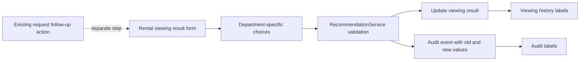

# Rental Viewing Result Statuses

* **Author:** ukbingoopaysafe
* **Status:** Superseded
* **Canonical version:** [`design.md`](../design.md)
* **Date:** 2026-11-10

## Overview

Rental employees need viewing results that match the outcomes they record in their daily work. This change gives them five clear result choices for each viewing while keeping the resale team's current choices in place until that team is consulted. The result records what happened at the viewing; it does not schedule another viewing, close the request, or create a deal.

## The Problem

The current rental viewing form offers general outcomes such as “interested,” “not interested,” “wants another viewing,” “started negotiation,” and “cancelled.” Rental employees have agreed on a different set that distinguishes a customer reservation, an unsuitable unit, interest in viewing another apartment, a completed rental, and a pending customer reply.

Without these choices, staff cannot record the agreed rental outcomes in a consistent way. The new list must also keep the distinction between a customer reserving a unit and completing its rental, and it must preserve the reason when a unit is marked unsuitable.

## Goals

* Show exactly these five choices when recording a rental viewing result: `حجز`, `غير مناسبة`, `يرغب بمعاينة شقة أخرى`, `تم التأجير`, and `انتظار الرد`.
* Define `حجز` as the customer reserving the unit associated with the viewing.
* Define `تم التأجير` as completing the rental of the unit associated with the viewing to that same customer.
* Define `انتظار الرد` as waiting for the customer's response.
* Require a reason whenever a rental viewing result is saved as `غير مناسبة`.
* Record `يرغب بمعاينة شقة أخرى` as the customer's intent only; selecting it does not create an appointment.
* Keep resale viewing choices and behavior unchanged until resale employees are consulted.
* Keep existing viewing results readable and preserve their values unless an employee explicitly changes the result.
* Keep the next follow-up as a separate action in the current workflow.

## Non-Goals

* Change the resale viewing outcome choices before its employees provide requirements.
* Schedule another viewing or choose another apartment from the result form.
* Automatically close a request or create a deal when a viewing result is saved.
* Add a new follow-up schedule, reminder, or alert for `انتظار الرد`.
* Rewrite historical viewing result values.

## Technical Plan (Architecture)

### Data Flow

The result remains attached to one viewing. The rental form presents the rental vocabulary; the server validates the selected value for the viewing's department and requires a reason for `غير مناسبة`. The service updates the viewing and records the old and new values in the existing audit event within the same transaction. Viewing history and the audit screen translate stored values into Arabic labels, including legacy values. The employee uses the existing request follow-up action separately.

The database already stores each viewing result in a nullable string column with a 24-character limit. New internal identifiers can fit that column, so this change does not require a database migration. Arabic text remains display-only; stable identifiers are stored. No existing result is rewritten. Resale keeps its current identifiers and validation until its employees define a new vocabulary.

When a rental result is changed, the current value is replaced and the existing audit event retains the `from` and `to` values. History distinguishes a pending customer reply from a viewing that has no result. The audit formatter must translate result values in those transition fields as well as direct `result` fields. A reason belongs to the current viewing result: it is required when saving `غير مناسبة` and cleared when the result changes to a different outcome. Existing records remain readable without applying new validation to a read.

### Selected Approach: Department Checks in Existing Callers

Keep the current structure and add rental/resale branches in the form, service validation, history template, and audit formatter. Rental uses five stable internal identifiers with the approved Arabic display labels; resale keeps its existing identifiers and behavior. The Arabic phrases are not stored as database values. The new identifiers must fit the existing 24-character result column, so no database migration is needed.

For rental, validation accepts only the five new identifiers and requires a reason for `غير مناسبة`. For resale, validation continues to accept its existing identifiers and retain its current reason rule. When a result changes away from `غير مناسبة`, clear its reason so the reason cannot appear attached to a different outcome. Do not apply new validation rules just to read an old record; preserve old results in viewing history and when an employee has not explicitly changed them.

The history and audit formatters translate both the new rental identifiers and the old identifiers. For audit events, translate `from` and `to` values as viewing results only when formatting `viewing.result_recorded`; do not treat every `from` or `to` field in other event types as a viewing result. An explicit result change replaces the viewing's current result, while the existing audit event retains the previous and new values.

This approach avoids adding a new class and keeps the change in the current files. Its trade-off is that result definitions are repeated across several files and can drift. Feature coverage must check that the rental form, server validation, history, and audit agree, while resale behavior stays unchanged. No result schedules a viewing, closes a request, or creates a deal; setting the next follow-up remains a separate existing action.

## Detailed Implementation Plan

### Target Files to Create/Modify

#### 1. `app/Filament/Support/SectionRequestResource.php` (Modify)

* **Type / Scope:** Shared rental and resale request actions.
* **Proposed Changes:** Branch the result options by `static::department()`. For rental, show only the five approved Arabic labels using stable stored identifiers: `reserved`, `unsuitable`, `other_apartment_viewing`, `rented_same_unit`, and `awaiting_customer_reply`. For resale, retain the current five options and identifiers. Change the rental reason field label to `سبب عدم المناسبة`; keep the existing resale label. Do not add scheduling, request-closing, deal-creation, or follow-up-date fields to this action.
* **Rationale:** The form is shared by both departments, while the author approved the new vocabulary only for rental.

#### 2. `app/Services/RecommendationService.php` (Modify)

* **Type / Scope:** Server-side viewing result validation and persistence.
* **Proposed Changes:** Validate the result against the current department's allowed identifiers. Require a reason for rental `unsuitable` and preserve resale's current conditional rule. When a rental result changes away from `unsuitable`, clear its reason. Keep the update and audit write in the existing transaction, recording the previous and new result identifiers. Do not change the request, recommendation, deal, or follow-up state.
* **Rationale:** UI filtering alone does not protect the service boundary; the server must enforce the same department-specific choices without changing the existing business flow.

#### 3. `resources/views/filament/modals/request-property-history.blade.php` (Modify)

* **Type / Scope:** Viewing history result and reason display.
* **Proposed Changes:** Render Arabic labels for the five new rental identifiers and retain readable labels for the five legacy identifiers. Keep resale labels unchanged. Display the rental reason as `سبب عدم المناسبة`. Preserve the existing fallback for results that are empty or unknown so `انتظار الرد` is distinct from a result that has not been recorded.
* **Rationale:** Old and new values must remain understandable in the request's history without rewriting stored rows.

#### 4. `app/Filament/Support/AuditEventResource.php` (Modify)

* **Type / Scope:** Audit event before/after value formatting.
* **Proposed Changes:** Make the formatter aware of event key and department. For `viewing.result_recorded` only, translate `from` and `to` result identifiers using the rental or resale label map, including legacy identifiers. Leave other event types' `from` and `to` values unchanged.
* **Rationale:** Viewing result changes are audited as `from`/`to`, but the current formatter only translates a field named `result`.

#### 5. `tests/Feature/RecommendationWorkflowTest.php` (Modify)

* **Type / Scope:** Recommendation service feature tests.
* **Proposed Changes:** Cover the five rental identifiers, reject a rental result outside the new list, require a reason for `unsuitable`, clear the reason when changing away from it, and confirm that resale still accepts its current identifiers while rejecting rental-only identifiers. Assert that the viewing update records the correct old/new audit values and does not close the request or create a deal.
* **Rationale:** This protects server validation, the department boundary, result lifecycle, and the explicit deal workflow.

#### 6. `tests/Feature/FilamentUiAccessTest.php` (Modify)

* **Type / Scope:** Filament request action and presentation tests.
* **Proposed Changes:** Update the existing rental viewing-result action test to use a new identifier. Assert the rental form's five labels and reason wording, keep the resale form's existing labels, and verify that history and the rental audit list render new and legacy result labels correctly.
* **Rationale:** The shared UI must expose the right list to each department and display stored codes as readable labels.

#### 7. `tests/Feature/ViewingAuditAtomicityTest.php` (Modify)

* **Type / Scope:** Viewing update transaction test.
* **Proposed Changes:** Use a valid new rental result identifier when simulating audit-write failure; retain the assertion that the viewing update rolls back with the failed audit write.
* **Rationale:** The current test uses an old rental identifier that will no longer be accepted for new submissions.

#### 8. `docs/DECISIONS.md` (Modify)

* **Type / Scope:** Approved decision ledger.
* **Proposed Changes:** Add `D-085` recording the five rental outcomes and meanings, the required reason for `غير مناسبة`, the rental-only scope, unchanged resale choices pending consultation, and the rule that viewing outcomes do not schedule appointments, close requests, or create deals.
* **Rationale:** These are owner-approved operating rules and should remain discoverable after this conversation.

#### 9. `docs/PRD.md` (Modify)

* **Type / Scope:** Product requirement index.
* **Proposed Changes:** Reference `D-085` from `PRD-042` so the viewing-result vocabulary and department scope are linked to the requirement for recording viewing outcomes.
* **Rationale:** The PRD should point readers to the decision that defines the accepted values.

#### 10. `docs/WORKFLOWS.md` (Modify)

* **Type / Scope:** Staff workflow documentation.
* **Proposed Changes:** Update rental section 2.4 with the five results, their meanings, the reason requirement, and the separate next-follow-up step. State that the new values do not apply to resale until its employees are consulted; do not change the resale workflow in section 3.4.
* **Rationale:** Staff need an accurate description of what each outcome means and what happens after recording it.

#### 11. `docs/ACCEPTANCE_TESTS.md` (Modify)

* **Type / Scope:** Product acceptance criteria.
* **Proposed Changes:** Update `AT-162` to cover rental's five outcomes, required reason, history/audit readability for legacy values, unchanged resale choices, and the absence of automatic scheduling, request closure, or deal creation.
* **Rationale:** The acceptance criterion should describe the behavior the implementation must preserve.

### Verification Plan

* **Compilation / Build:** No schema migration or asset build is required. Run `php -l` on the modified PHP files.
* **Feature Tests:** Run `php artisan test --filter=RecommendationWorkflowTest`, `php artisan test --filter=FilamentUiAccessTest`, and `php artisan test --filter=ViewingAuditAtomicityTest`.
* **Full Test Suite:** Run `php artisan test` after the focused tests pass.
* **Manual UI Check:** In rental requests, confirm the five labels, the required reason for `غير مناسبة`, readable history/audit labels, and no automatic request or deal change. In resale requests, confirm the current choices and validation remain unchanged. Confirm the separate next-follow-up action still works as before.
