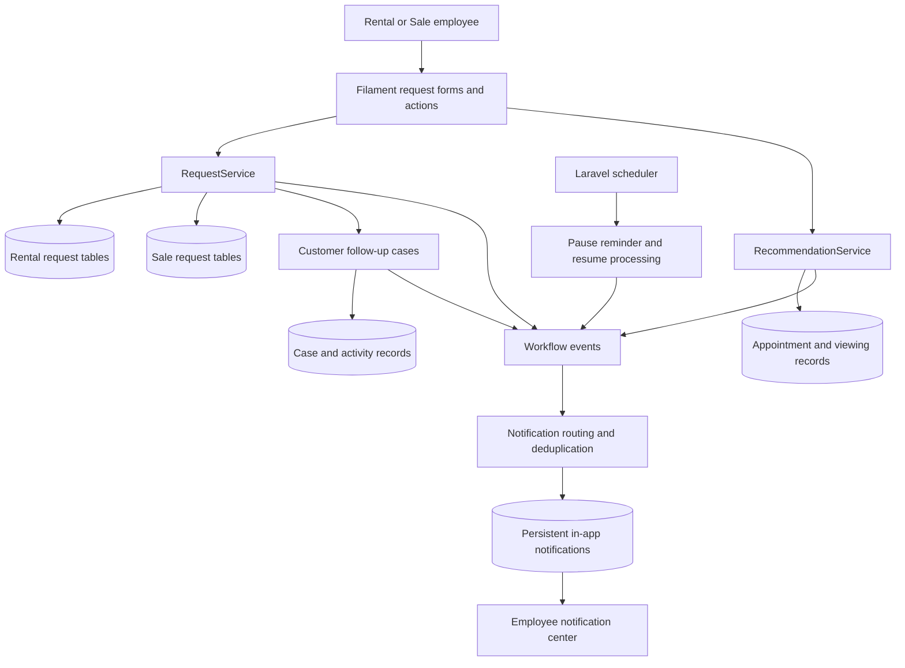

# Rental and Sale Request Management and Customer Follow-up

* **Author:** ukbingoopaysafe
* **Status:** Superseded by [design.md](design.md); retained as the original planning draft.
* **Date:** 2026-11-16

## Overview

This design updates how employees record and manage Rental and Sale requests, viewings, outcomes, and customer follow-up. It gives both departments a shared request progression and budget language while keeping Rental furnishing choices and Sale property requirements specific to their workflows. It also gives employees a way to inspect broker requests and receive in-app reminders for work that needs attention.

## The Problem

The current request workflow does not consistently reflect how the team works. Rental and Sale need some of the same information, but their forms and stored values do not consistently support the requested categories. The current stages do not match the four steps staff want to use, and budget labels do not distinguish the customer's stated budget from the employee's estimate of the market.

Some important work also depends on memory or manual handling. A paused request has no planned resume date or automatic return to active status. A viewing cannot be recorded until a time is agreed, and appointment changes are mixed with viewing results. Staff can see how many requests a broker has but cannot inspect those requests from the broker page. Follow-up must distinguish successful requests, failed requests, and legacy customers with no request, while preserving each customer's history. A central in-app notification workflow does not currently cover these actions.

Without these changes, employees may record similar requests differently, lose the history of changed appointments, overlook a due follow-up, or have difficulty finding the request behind a customer or broker interaction.

## Goals

* Give Rental and Sale employees consistent client-category, people-count, budget, and request-stage fields, with the department-specific fields each workflow needs.
* Record successful and unsuccessful closure with a timestamp, require a closure classification for an unsuccessful request, and retain general notes.
* Let employees pause a request with a reason and resume date, receive a reminder before that date, and have the request return to active status automatically on the planned date.
* Record a viewing before its time is agreed, retain postponed and cancelled appointment history, and record a viewing result only after the appointment is completed.
* Let employees inspect a broker's requests and group customer follow-up by each request's outcome or by a legacy customer's lack of a recorded request.
* Notify the responsible employee in the application about assignments and due work, and route overdue follow-up to the responsible manager without duplicate alerts.
* Keep every database change in a checked-in migration file so it can be applied after pulling the code to another environment.

## Non-Goals

* Delivering notifications through email, SMS, or WhatsApp in the first version.
* Separating follow-up by whether a rental or sale period is active or expired.
* Changing Sale's current finishing label or options.
* Building a separate marketing attribution or market-budget analytics system.
* Deleting current dummy data or migration history as part of these workflow changes; the planned final data reset is separate.

## Open Questions

No business decisions remain open for this scope. Unsuccessful requests reuse the existing active closure-classification catalog; this design does not add or replace its entries. Scheduler times use the application's Cairo timezone.

## Critical User Journeys

### Create and update a Rental or Sale request

* **Given** an employee is working in an authorized department and has at least one valid request contact.
* **When** the employee records the client category, people count, unit requirements, customer budget, market estimate, and request stage.
* **Then** the system validates and stores the department-specific fields, shows the approved labels and choices, and keeps the request within that department.

### Pause and automatically resume a request

* **Given** an active request has an owner and a next follow-up date.
* **When** the employee pauses it with a reason, resume time, and first follow-up date after resumption.
* **Then** the system stops ordinary follow-up notices, reminds the current owner one week before the resume time, and reactivates the request at the same stage when due. If the scheduler missed the time, it catches up without reopening a closed request or duplicating notices.

### Record a viewing attempt

* **Given** an active request has a recommended unit.
* **When** the employee records an appointment before the time is known, schedules it, completes it, postpones it, or cancels it.
* **Then** each attempt remains in history; only a completed attempt accepts a result, and Sale offers its four approved result choices.

### Close a request and follow up with its customer

* **Given** a request is ready to close.
* **When** the employee records a successful or unsuccessful outcome.
* **Then** the system timestamps the closure, requires an active classification for an unsuccessful outcome, and creates a separate case for the known customer and that closed request. A legacy case is available only when the department has no request for that customer.

### Inspect broker requests and act on notifications

* **Given** an employee is authorized for a department and opens one of its broker records.
* **When** the employee opens the broker's request history or selects an in-app notification.
* **Then** the employee sees only authorized requests; the notification links to its source record and can be marked read without granting edit access.

## Technical Plan

### Request forms and shared workflow

Keep the Rental and Sale request tables and models separate because their property requirements differ. Continue using the shared request form and request service for common behavior, with department-specific field rules.

Add a four-value client category and people count to both request types. Rental's current `household` boolean cannot represent these values, and Sale has neither field. Add the Sale purchase requirements as structured request data: bedroom count, bathroom count, building year, elevator, water meter, electricity meter type (`قديم` or `كارت`), and gas. Represent unanswered preferences separately from an explicit “no” so a blank value does not become a false requirement. Keep these fields nullable unless the request workflow explicitly asks the client and records an answer.

Keep the current budget columns and change their labels in create, edit, detail, list, and export views. The customer budget stores the amount stated by the customer; the market budget stores the request owner's estimate. In Rental, update the finishing field's label and choices to the approved furnishing vocabulary. Leave Sale's finishing vocabulary unchanged. Remove only the two named test-campaign lead sources wherever the section catalogs expose them.

Update both stage enums and the stage selector to the four approved values. New requests start at `بحث عن وحدات`. In a checked-in forward migration, map only the obsolete `intake` and `qualification` values to the new initial stage before removing those enum cases. The owner approved this targeted stage conversion; unrelated dummy data is not cleaned or mapped by these migrations. Keep `closed_at`; display its date and time for both outcomes. For unsuccessful closure, require the existing classification field, remove the separate free-text reason input and validation, and retain general outcome notes.

### Pause, viewing, and follow-up

Extend the request lifecycle with a required pause reason, planned resume time, and first follow-up date after resumption. The scheduler sends one reminder to the current request owner one week before resumption, resumes only requests that are still paused and open, restores the saved follow-up date, and catches up after missed scheduler runs without duplicate notices. A close or manual resume cancels pending pause work. Stop ordinary follow-up reminders while paused. Escalate an active request's overdue follow-up to each manager for its department once, after 24 hours overdue; retire the escalation if the request is closed, paused, reassigned, or given a new follow-up date.

Keep Sale and Rental viewing result choices department-specific. Make appointment time optional until agreed, represent scheduling state separately from the outcome, retain cancelled and postponed attempts, and allow a result only after a completed viewing. The author selected one record per appointment attempt: a completed attempt stores its result, a postponed attempt remains in history and leads to a new attempt, and a cancelled attempt has no result.

Replace the current one-profile-per-customer aftercare shape with outcome cases under `D-090`. Create one case per closed request linked to a known customer, derive success/failure from the request outcome, link the deal when available, and attach activity, owner, and due date to that case. Create a customer-keyed legacy case only when the customer has no request in the relevant department. Group cases by customer in the UI while showing each case's request or deal identity. Keep unmatched historical profiles and activities stored without assigning an outcome that cannot be proven.

Add a read-only broker request action using the existing broker-to-request relationship and the customer request-history interaction as a UI reference. Keep the sale department label change in navigation and other user-facing labels.

### In-app notifications

Add a persistent in-app notification center for assignment, follow-up due/overdue, viewing schedule changes, pause reminder/resumption, request closure, and customer-case follow-up. Use Laravel's database notification channel and standard `notifications` table, with a checked-in migration adding event metadata and a unique deduplication key scoped to recipient and event. Each item links to its source record, has read/unread state, and is routed to the current responsible employee. Escalate an active request's overdue follow-up to every manager authorized for its department once, after 24 hours overdue. Build the deduplication key from recipient, source record, event, due date, and owner; update or retire stale reminders after reassignment, rescheduling, closure, or resumption. A scheduled process must recover missed due events and avoid sending duplicate notifications. This uses the application's existing `Notifiable` support and keeps persistence in the framework's in-app notification system.

### Data flow

Add new database changes as checked-in Laravel migrations. Do not edit previously applied migration files or erase them. The planned deletion of dummy data happens separately; until then, migrations and deployed code must safely handle the current rows. Keep Rental and Sale data boundaries explicit, while sharing common workflow rules through the existing department-aware services.

### Selected viewing storage model

Use the existing viewing record family with one row per appointment attempt. Add a nullable appointment time and appointment state while keeping the result in its own field. A row with state `completed` may have one result; rows with state `postponed` or `cancelled` have no result. When a postponed appointment is arranged again, create a new row linked to the prior attempt. This fits the approved workflow: one completed appointment yields at most one result, while schedule changes remain visible as separate attempts.

### Selected notification persistence

The owner selected Laravel's database notification channel. Add the standard `notifications` table and a unique event key to prevent duplicate rows for the same recipient and actionable event. Store the event type, source model and ID, due date, current owner, and navigation link in the notification data. The scheduled processor looks up or creates a notification using that key. If the owner or due date changes, mark the old notification as superseded/read and create a notification for the current owner and due date. Use Laravel's `read_at` field for read/unread state. Do not add email, SMS, or WhatsApp channels in this phase.

## Alternatives Considered

### Duplicate budget fields instead of relabeling the existing fields

* **Pros**: The old declared and targeted values could remain separately available while the new client and market amounts are recorded.
* **Cons**: Employees would have four budget fields to interpret, and reports could disagree about which pair is current.
* **Reason for Rejection**: Rejected by author. The owner clarified that the existing fields are the fields to relabel as `ميزانية العميل` and `ميزانية السوق`; separate values would duplicate the same business facts.

### One aftercare status per customer

* **Pros**: One row per customer is simple to list and prevents the same person appearing in multiple groups.
* **Cons**: A customer can have several successful and failed requests. A single status would hide earlier or concurrent request outcomes and make case activities share a schedule that belongs to different requests.
* **Reason for Rejection**: Rejected by author. Follow-up is categorized by each request outcome, with a separate item for an older customer who has no request recorded. The same customer may therefore appear in more than one outcome group.

### Separate viewing appointments and viewing results

* **Pros**: Appointment scheduling and the outcome of an actual viewing each have an independent record and lifecycle.
* **Cons**: This adds tables and joins, and can duplicate data when each completed appointment has one result.
* **Reason for Rejection**: Rejected by author. The owner selected one record per appointment attempt, with separate state and result fields. Postponements create a new attempt; only completed attempts store a result.

### A custom notification store instead of Laravel database notifications

* **Pros**: A purpose-built table can store workflow delivery and recovery states directly, with domain-specific queries.
* **Cons**: It requires a custom notification model and center, duplicating Laravel's in-app notification facilities and adding another persistence model.
* **Reason for Rejection**: Rejected by author. The owner selected Laravel's database notification channel with a deduplication key for the in-app-only first phase.

### External notification channels in the first release

* **Pros**: Email, SMS, or WhatsApp could reach employees while they are away from Cible.
* **Cons**: Each channel needs provider setup, delivery rules, retry behavior, and controls for duplicate or sensitive messages.
* **Reason for Rejection**: Deferred by the owner-approved scope. Start with in-app notifications; revisit external delivery if staff need alerts outside the system.

### One shared request table for Rental and Sale

* **Pros**: Shared request behavior and reports could use one schema and a single stage definition.
* **Cons**: Rental and Sale have different requirements, and a unified table would accumulate department-specific nullable fields and conditional validation.
* **Reason for Rejection**: The approved Technical Plan keeps each department's persisted request model separate and shares only behavior that is common to both.

## Non-Functional Requirements

* **Access control:** All request, broker, follow-up case, activity, and notification links must enforce existing department authorization on the server. Hidden UI controls are not an access boundary.
* **Data integrity:** Request closure and case creation must be transactional. Unique request and legacy-customer keys prevent duplicate follow-up cases. Notification event keys prevent duplicate reminders for one recipient and actionable event.
* **Scheduler recovery:** Scheduled processing runs every minute, uses Africa/Cairo application time, catches up after downtime, and locks due requests before resuming or notifying. Closed or manually resumed requests cannot be reopened by a stale scheduler run.
* **Migration safety:** New migrations are committed and forward-only when a reverse operation would lose data. They preserve existing history and do not reset dummy data or edit previously applied migrations.
* **Section isolation:** Rental and Sale keep separate request, customer, broker, deal, and follow-up records. Shared code may not expose the other section's records or counts.

## Detailed Implementation Plan

The approved scope is recorded as `D-090` for customer follow-up cases, `D-091` for unsuccessful closure, and `D-092` for request fields and stages. These decisions replace the older one-profile-per-customer aftercare rule, free-text closure-reason rule, and request-field/stage baseline. The implementation keeps Rental and Sale records separate and adds new forward migrations; it does not edit an applied migration or remove historical request, viewing, activity, or notification data.

### Implementation sequence

1. **Add forward-only schema and data migrations.** Create the following files. Do not edit an applied migration. A rollback must not drop populated fields or erase transformed history; the stage conversion is intentionally forward-only because the two old stages map to one new stage. Correct mistakes with a new forward migration.

   * `database/migrations/2026_11_16_010000_add_request_requirement_fields.php` — add nullable `client_category` to both request tables; add `occupants` to Sale; add Sale `bedrooms`, `bathrooms`, `building_year`, nullable boolean `elevator_required`, `water_meter`, and `gas_available`, and nullable `electricity_meter_type`. Keep unanswered yes/no preferences null. Keep the existing Rental `household` boolean and occupant count as historical data; do not infer a new category from the old boolean. Rental furnishing uses the existing storage columns, so this migration does not translate old dummy furnishing values.
   * `database/migrations/2026_11_16_020000_align_rental_and_resale_request_stages.php` — update both stage columns and defaults to `unit_search`, `recommendation`, `viewing`, and `negotiation`. Convert only `intake` and `qualification` rows to `unit_search`; preserve every other value and its history. This is the only approved stage data conversion.
   * `database/migrations/2026_11_16_030000_add_request_pause_schedule_fields.php` — add `pause_reason`, `resume_at`, and `resume_follow_up_at` to both request tables. Keep these values nullable for requests that were never paused, and do not rewrite existing pause history.
   * `database/migrations/2026_11_16_040000_add_viewing_attempt_state.php` — make `scheduled_at` nullable, add `appointment_status` and nullable `rescheduled_from_id` with a self-reference to the prior attempt in each viewing table. Convert historical cancellation result markers into cancelled appointment state with no result; treat rows with a result as completed and rows without one as scheduled. Preserve feedback, notes, actor, and timestamps.
   * `database/migrations/2026_11_16_050000_convert_aftercare_to_follow_up_cases.php` — change each existing `*_aftercare` table from a unique customer profile into a case table: remove the unique constraint on `customer_id`, add nullable `request_id` and category columns, add a unique request constraint, and add nullable unique `legacy_customer_id` so one request cannot create duplicate cases and a no-request case remains unique per customer. Backfill one case for each closed request with a known customer. Attach each existing profile to the earliest successful request with a deal, preserving its owner and due date; move deal-linked activities to the case for that deal's request, and leave activities without a deal on the existing profile's case. Convert a profile with no requests into a legacy case. Preserve unmatched historical profiles and activities without assigning a false category. Do not drop or truncate the existing aftercare tables or activity rows.
   * `database/migrations/2026_11_16_060000_create_workflow_notifications_table.php` — create Laravel's database notifications table with its standard recipient, payload, read timestamp, and UUID fields. Add a generated/indexed deduplication key derived from notification data and a uniqueness constraint scoped to notification recipient. Keep notification history when request records change.
   * `database/migrations/2026_11_16_070000_disable_test_campaign_lead_sources.php` — deactivate only the exact Rental and Sale test-campaign source rows if present. Do not delete source rows, rename other options, or change historical request source values.

2. **Update request types, validation, lifecycle services, and forms.**

   * Update `app/Enums/RentalRequestStage.php` and `app/Enums/ResaleRequestStage.php` to expose the four shared stages and their Arabic labels. Add `app/Enums/RequestClientCategory.php` for family, youth, students, and other; add `app/Enums/RentalFurnishingType.php` for «بلاط», «عادية», «لوكس», «سوبر لوكس», «فندقية», and «أخرى»; add `app/Enums/ElectricityMeterType.php` for old and card meters. Leave `app/Enums/FinishingLevel.php` and Sale finishing options unchanged. Update `app/Enums/Department.php` so the Sale label shown to users is «البيع», while keeping its stored enum value unchanged.
   * Update `app/Models/RentalRequest.php` and `app/Models/ResaleRequest.php` for the new request fields, date casts, and typed enum casts. Keep the Rental and Sale models and tables independent.
   * Update `app/Filament/Support/RequestFormSchema.php`, `app/Filament/Support/SectionRequestResource.php`, and `app/Services/RequestService.php` so create, edit, detail, request-list columns, filters, and server-side validation use the approved categories, Sale requirements, four stages, and budget labels. New requests default to `unit_search`. Keep existing values when an edit does not touch them; historical Rental furnishing values remain visible as legacy values for their current record but are not offered for a new selection.
   * In the same schema and service, remove the household toggle from active forms, retain the count field, and validate optional Sale property preferences without treating an unanswered value as “no”. Use the Rental-specific furnishing list only for Rental. Relabel the existing budget columns as customer budget and market budget; the customer amount is the amount stated by the client and the market amount is the responsible employee's estimate for comparable current units.
   * Update unsuccessful close validation and its action in `app/Services/RequestService.php` and `app/Filament/Support/SectionRequestResource.php`: require `outcome_reason_id` only for an unsuccessful outcome, remove `outcome_reason_text` from the active close form and new-write validation, and leave general outcome notes optional. Keep historical `outcome_reason_text` values stored; do not write or require them for new closures. Show the existing `closed_at` date and time for both outcomes.
   * Update pause and resume actions in `app/Services/RequestService.php` and `app/Filament/Support/SectionRequestResource.php`. Pausing requires a reason and resume date/time. The form also captures the first follow-up date after resumption so automatic activation cannot create an active request without the follow-up required by `D-008`. On scheduled resumption, restore the request to active at the same stage, apply that saved next follow-up, clear pause fields, and audit the transition. Manual resume and closure clear the planned resume values and retire pending pause notices.
   * Update `app/Exports/RentalRequestExporter.php` and `app/Exports/ResaleRequestExporter.php` to export the new requirements and the customer/market budget labels. Keep department-specific columns within their own export.

3. **Separate viewing appointment state from viewing result.**

   * Add `app/Enums/ViewingAppointmentStatus.php` with `pending_schedule`, `scheduled`, `completed`, `postponed`, and `cancelled` states. Update `app/Models/RentalViewing.php` and `app/Models/ResaleViewing.php` to cast the optional time and expose the `rescheduled_from_id` relationship.
   * Update `app/Services/RecommendationService.php` and the viewing actions in `app/Filament/Support/SectionRequestResource.php` to allow creation before a time is known. A completed attempt may have a result; pending, scheduled, postponed, and cancelled attempts may not. Postponement closes the current attempt as postponed and creates a new attempt linked to it; cancellation keeps the attempt and has no result. Show the prior and current attempts in history.
   * Keep Rental result choices unchanged. For Sale, offer only «يفكر ويدرس المكان والخدمات», «التفاوض في السعر», «معاينة مرة أخرى», and «محتاج شقة أخرى». Show the result field only when the appointment is completed.
   * Update `resources/views/filament/modals/request-property-history.blade.php` so missing appointment time is displayed as not scheduled and the history distinguishes scheduled, postponed, cancelled, and completed attempts without presenting cancellation as a result.

4. **Implement request-based customer follow-up while preserving the existing records.**

   * Add `app/Enums/CustomerFollowUpCategory.php` with successful, unsuccessful, and legacy-without-request categories. Update `app/Models/RentalCustomerFollowUp.php` and `app/Models/ResaleCustomerFollowUp.php` to link one case to its request or through `legacy_customer_id`, and expose the case category. Update `app/Models/RentalCustomerFollowUpActivity.php` and `app/Models/ResaleCustomerFollowUpActivity.php` to retain their existing history and resolve the parent case.
   * Update `app/Services/CustomerFollowUpService.php` to create or find one case per closed request with a known customer, using the request result for the category and the request owner as the initial case owner. If a customer is linked to a request after it has closed, create that request's case then, without reopening the request. Create a legacy case from the customer page only when that customer has no request in that department. If a legacy customer later gains a request, keep the old activity history but stop showing the legacy case in the no-request group; create a new request case when that request closes.
   * Change activity recording and history lookup to require a specific case ID. Keep activities manual and immutable, preserve optional activity notes and next follow-up date, and validate that an optional deal belongs to the case's customer and department. Keep each case's responsible employee and next follow-up date independent; a customer's different request cases must not share one schedule.
   * Update `app/Filament/Support/CustomerFollowUpResource.php`, `app/Filament/Support/CustomerResource.php`, `app/Filament/Resources/RentalCustomerFollowUps/RentalCustomerFollowUpResource.php`, and `app/Filament/Resources/ResaleCustomerFollowUps/ResaleCustomerFollowUpResource.php` to group cases by successful, unsuccessful, and no-request categories and show the request or deal identity. Add the customer-page action that creates a legacy case only when no request exists. Do not show an unmatched historical profile as if its category were known.
   * Update `resources/views/filament/modals/customer-follow-up-history.blade.php` to show history for the selected case, its request/deal identity, and its independent next follow-up date.
   * Update `app/Filament/Widgets/OperationalRequestsOverview.php` to query case-level due follow-ups and keep Rental and Sale counts separate.

5. **Expose broker requests and apply Sale terminology consistently.**

   * Update `app/Filament/Support/BrokerResource.php`, `app/Filament/Resources/RentalBrokers/RentalBrokerResource.php`, and `app/Filament/Resources/ResaleBrokers/ResaleBrokerResource.php` to add a read-only request-history action and scope the query to the broker's own section. Add `resources/views/filament/modals/broker-requests.blade.php` to show the broker's requests without granting edit actions.
   * Replace user-facing «إعادة البيع» wording with «البيع» in `app/Filament/Support/AuditEventResource.php`, `app/Filament/Resources/Areas/AreaResource.php`, `app/Filament/Resources/ResaleRequests/ResaleRequestResource.php`, `app/Filament/Resources/ResaleCloseReasons/ResaleCloseReasonResource.php`, `app/Filament/Resources/ResaleBrokers/ResaleBrokerResource.php`, `app/Filament/Resources/ResaleAreas/ResaleAreaResource.php`, `app/Filament/Resources/ResaleLeadSources/ResaleLeadSourceResource.php`, `app/Filament/Resources/ResaleAuditEvents/ResaleAuditEventResource.php`, `app/Filament/Resources/ResaleCustomerFollowUps/ResaleCustomerFollowUpResource.php`, and `app/Filament/Resources/ResaleCustomers/ResaleCustomerResource.php`. Keep internal class, route, table, enum, and database identifiers stable.

6. **Add persistent, deduplicated in-app workflow notifications.**

   * Add `app/Notifications/WorkflowEventNotification.php` to serialize a short Arabic message, event key, department, source type and ID, due time, current owner, and authorized in-app link through Laravel's database notification channel.
   * Add `app/Services/WorkflowNotificationService.php` to route and deduplicate assignment, follow-up due and overdue, viewing created/rescheduled/cancelled, pause reminder, automatic resumption, closure, and customer-case follow-up notifications. Wire it to `RequestService`, `RecommendationService`, and `CustomerFollowUpService` after successful state changes. Notify the current request or case owner. Escalate a request follow-up to every manager authorized for that department once after it has been overdue for 24 hours; do not escalate if the request was closed, paused, reassigned with a new due date, or updated. Key reminders by recipient, source, event, due time, and owner so changed dates or owners retire stale reminders and produce one current notice.
   * Add `app/Console/Commands/ProcessWorkflowNotifications.php` to process due events transactionally with row locks. Run it every minute from `routes/console.php`. Send the pause reminder seven days before resume; if the pause is created less than seven days before resumption, send the reminder immediately. If the scheduler was stopped until after the resume time, resume the request first and skip the obsolete pause reminder. Use Cairo application time, catch up overdue work on the next run, and rely on the unique event key to prevent duplicates.
   * Update `app/Providers/Filament/AdminPanelProvider.php` to enable Filament's database notification bell and unread list. Keep each notification link subject to the existing section authorization checks. No email, SMS, or WhatsApp delivery is added.

7. **Update project records and verify the feature.**

   * `docs/DECISIONS.md` has been updated in this drafting step with `D-090` through `D-092`; implementation must keep these decisions and their superseded references aligned.
   * Update `docs/PRD.md` for the approved request fields, stage list, Sale label, closure rule, viewing lifecycle, case categories, and in-app notifications.
   * Update `docs/WORKFLOWS.md` with the create/edit, close, pause/resume, viewing attempt, broker history, and follow-up case flows, including the saved post-resumption follow-up date and 24-hour manager escalation rule.
   * Update `docs/DATA_MODEL.md` with the new Rental and Sale request fields, viewing attempt state, follow-up case relationships, dedupe key, and all forward migration names. Retain existing table names required by `D-084`.
   * Update `docs/ACCEPTANCE_TESTS.md` with field validation, targeted stage migration, close classification, pause reminder and automatic resumption, no-result cancellation, Sale viewing outcomes, per-request follow-up isolation, broker request visibility, notification deduplication/escalation, and department isolation.
   * Update `docs/OPERATIONS.md` with the new scheduler task and the deployment sequence: pull the commit, run `php artisan migrate --force`, then confirm scheduler execution and notification processing. Keep every migration file committed for the separate production environment.
   * Update `tests/Feature/RequestLifecycleTest.php`, `tests/Feature/RequestTableSemanticUxTest.php`, `tests/Feature/RecommendationWorkflowTest.php`, `tests/Feature/ViewingAuditAtomicityTest.php`, `tests/Feature/BrokerWorkflowTest.php`, `tests/Feature/BrokerActionsMenuStructureTest.php`, `tests/Feature/CustomerActionsMenuStructureTest.php`, `tests/Feature/RequestActionsMenuStructureTest.php`, `tests/Feature/LeadSourceCatalogTest.php`, `tests/Feature/LeadSourceRequestFormTest.php`, `tests/Feature/LeadSourceRequestServiceTest.php`, `tests/Feature/LeadSourceExportTest.php`, `tests/Feature/FilamentUiAccessTest.php`, and `tests/Feature/DepartmentIsolationAcceptanceTest.php` for changed existing behavior.
   * Add `tests/Feature/RequestRequirementsTest.php`, `tests/Feature/RequestStageMigrationTest.php`, `tests/Feature/PauseResumeSchedulerTest.php`, `tests/Feature/ViewingAttemptLifecycleTest.php`, `tests/Feature/CustomerFollowUpCasesTest.php`, and `tests/Feature/WorkflowNotificationsTest.php` for the new data rules and scheduled workflows. These files define later verification; this design step does not run tests.
   * Keep the EGM brief, design, and Goldfish report in `docs/egm/request-management-and-follow-up/`. The approved design remains a planning artifact until implementation and a later review.

### Operational invariants

* New active requests always have a next follow-up date. A pause stores the date to use after resumption; automatic resumption restores the same stage and does not create a new request or deal.
* New unsuccessful closures always have a catalog classification. The old free-text column remains for historical values but is no longer written or required.
* A viewing result exists only on a completed attempt. A cancelled or postponed attempt remains visible in history with no result.
* A request case is unique per closed request. A legacy case is unique per customer and is shown in the no-request group only while that department has no request for the customer. All case and notification reads remain section-scoped.
* No applied migration is edited, no production data is reset, and no old lead source, aftercare activity, request, or viewing row is hard-deleted by these migrations.
