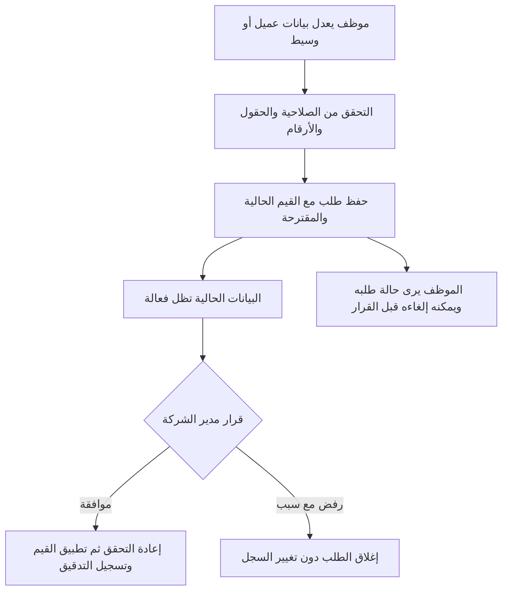

# موافقة المدير على تعديل بيانات العميل والوسيط

**الحالة:** مكتمل في الفرع  
**آخر تحديث:** 2026-11-04

اعتمد المالك التصميم في 2026-11-04، بما في ذلك منع أرشفة العميل أو حذف الوسيط إلى أن يُحسم طلب التعديل المعلق.

## الهدف

يُرسل تعديل الموظف على بيانات عميل أو وسيط إلى مدير الشركة للمراجعة. تظل البيانات الحالية هي المعتمدة في التطبيق إلى أن يوافق المدير؛ وعند الموافقة تُطبّق التغييرات، وعند الرفض لا تتغير البيانات. يحمي ذلك بيانات CRM من التعديلات غير المراجعة، مع حفظ من طلب التعديل ومن اتخذ القرار.

## ما يعمل حاليًا

- لكل من الإيجار وإعادة البيع سجلات عميل ووسيط مستقلة، وتُفرض صلاحيات القسم في الخدمة والخادم.
- تعديل العميل يمر عبر `CustomerResource` ثم `CustomerService::update()`، وتعديل الوسيط عبر `BrokerResource` ثم `BrokerService::update()`.
- الخدمتان تطبّعان أرقام الهاتف وتتحققان من التكرار والحقول، ثم تحفظان التعديل فورًا وتضيفان حدثًا إلى `AuditEvent`.
- `User::is_company_manager` يميز مدير الشركة؛ المدير يعمل في القسمين، والموظف يعمل في الأقسام المسندة إليه.
- يوجد تدفق موافقة لإعادة تعيين الطلب، لكن لا يوجد تدفق لموافقة تعديل العميل أو الوسيط. سجل التدقيق سجل للأحداث، وليس طابورًا لطلبات معلقة.

## القرارات المعتمدة لهذا التصميم

- اختار المالك صندوق مراجعة موحدًا للعملاء والوسطاء.
- اختار المالك سجل موافقة واحدًا مشتركًا بدل جدول مستقل لكل نوع سجل.
- صاحب القرار هو مدير الشركة الموجود في النظام، لا دور إداري جديد.

## النطاق

يشمل تعديل الحقول المتاحة حاليًا في نماذج العميل والوسيط داخل الأقسام الأربعة:

- العميل: الاسم، الجنسية، وقائمة أرقام الهاتف بما فيها الرقم الأساسي وترتيب الأرقام.
- الوسيط: الاسم وقائمة أرقام الهاتف بما فيها الرقم الأساسي وترتيب الأرقام.

لا يشمل التصميم موافقات على إنشاء سجل جديد أو أرشفة العميل أو حذف الوسيط أو تعديل الطلبات. تبقى هذه العمليات على قواعدها الحالية. تعديلات مدير الشركة على العميل أو الوسيط تُحفظ مباشرة.

## سير العمل المعتمد

1. يرسل الموظف النموذج كطلب تعديل، وتظل بيانات العميل أو الوسيط الحية دون تغيير.
2. يظهر الطلب في صندوق المدير الموحد مع القسم ونوع السجل واسم السجل ومقدم الطلب ووقت الإرسال.
3. تعرض شاشة المراجعة القيم الحالية والمقترحة جنبًا إلى جنب، بما يشمل الأرقام المتعددة والرقم الأساسي.
4. يوافق مدير الشركة أو يرفض الطلب. الرفض يتطلب سببًا قصيرًا حتى يعرف الموظف ما يحتاج إلى تصحيحه.
5. عند الموافقة يعيد الخادم التحقق من صلاحية المدير، ونطاق القسم، ووجود السجل، وصحة القيم، وتوفر الأرقام، وعدم تغير السجل منذ إنشاء الطلب. تظهر للمدير الأسماء المشابهة الموجودة وقت المراجعة، وتُطبق القيم داخل معاملة واحدة فقط بعد نجاح التحقق.
6. إذا تغيرت القيم الحية منذ إرسال الطلب، لا تُكتب القيم القديمة فوق التعديل الأحدث. يُرفض تطبيق الطلب كمتعارض، ويظل السجل دون تغيير إلى أن يحسم المدير الطلب.
7. يستطيع الموظف رؤية طلباته وقراراتها، وإلغاء الطلب المعلق الذي قدمه بنفسه. لا يرى طلبات الموظفين الآخرين.
8. يُسمح بطلب معلق واحد فقط لكل سجل في كل لحظة؛ يمنع ذلك وجود تغييرات متعارضة. بعد القرار أو الإلغاء يمكن إرسال طلب جديد.
9. يمنع أرشفة العميل أو حذف الوسيط ما دام له طلب تعديل معلق؛ يجب حسم الطلب أولًا.

## النهج والبدائل

### النهج المختار: جدول موحد لطلبات التعديل

جدول مستقل يحتفظ بنوع السجل والقسم، ومعرف السجل، ومقدم الطلب، والحالة، ولقطة القيم قبل التعديل وبعده، وصاحب القرار ووقته وسبب الرفض أو الإلغاء. تستخدم واجهة واحدة النطاق والصلاحيات بحسب دور المستخدم: المدير يراجع الطلبات، والموظف يرى طلباته فقط.

هذا النهج يطابق الصندوق الموحد ويجعل قواعد القرار والتدقيق مشتركة. بما أن ربط العميل أو الوسيط متعدد الأشكال، لا يوفر الجدول مفتاحًا أجنبيًا تقليديًا للسجل؛ لذلك يجب حصر أنواع السجلات المسموحة والتحقق من نوعها وقسمها داخل الخدمة قبل كل قراءة أو قرار.

### البديل: جدولان منفصلان

جدول للعميل وآخر للوسيط يوفران ربطًا أوضح بكل نوع، لكنهما يكرران دورة الحالة والخدمات والواجهات. لا يلزم هذا الفصل لأن المالك اختار شاشة مراجعة واحدة وقواعد قرار واحدة.

## قواعد الصلاحيات والحفظ

- يحق للموظف إرسال طلب إذا كان مخولًا بالعمل في قسم السجل، ولا يحق له اعتماد الطلب أو رفضه.
- مدير الشركة وحده يراجع الطلبات ويصدر القرار، مع فرض ذلك في الخدمة واستعلام القائمة، لا بإخفاء الأزرار فقط.
- تكون قائمة المدير موحدة، مع عمود/مرشح للقسم ونوع السجل؛ لا تُكشف سجلات قسم للموظف غير المخول به.
- يرى الموظف طلباته فقط، وبما يتصل بالقسم الذي يملك صلاحية العمل فيه.
- تُقبل أنواع نماذج العملاء والوسطاء الأربعة المعروفة فقط؛ لا يُسمح بإرسال اسم صنف أو معرف سجل اعتباطي من الواجهة.
- قفل سجل جهة الاتصال والطلب داخل معاملة يمنع اعتماد طلب مكرر أو تجاوز البيانات المتزامنة.
- تمر القيم المعتمدة عبر قواعد خدمات العميل والوسيط الحالية، ومنها تطبيع الهاتف، تكرار الأرقام، الرقم الأساسي، الجنسية، وتشابه الاسم؛ ولا تُحفظ مباشرة من JSON إلى الجداول.

## سجل التدقيق

- يُسجل إرسال الطلب باسم الموظف والقسم والقيم قبل/بعد.
- الموافقة تُسجل كحدث قرار باسم المدير، ويُسجل تطبيق البيانات كحدث تعديل باسم المدير المنفذ مع مرجع مقدم الطلب.
- الرفض والإلغاء يسجلان كقرار مع الحالة والسبب والوقت، دون استبدال أحداث سابقة.
- تبقى سجلات `AuditEvent` غير قابلة للتحرير أو الحذف. لا يُستخدم سجل التدقيق نفسه كحالة الطلب.

## أهداف واجهة الاستخدام

- صندوق واحد باسم واضح داخل «إدارة الشركة»، ظاهر لمدير الشركة فقط، وعدّاد يبين عدد الطلبات المعلقة.
- يبدأ العرض بالطلبات المعلقة؛ ويمكن للمدير فتح سجل الموافقات لمعرفة الطلبات المحسومة.
- تفاصيل الطلب تعرض الفروق بوضوح، وأسماء الحقول بالعربية، والأرقام مع تمييز الأساسي وترتيبها.
- إجراءات القرار واضحة ومحمية بالتأكيد. حقل سبب الرفض إلزامي.
- تظهر حالة الطلب للموظف، وتوفر له إلغاء طلبه المعلق فقط.
- لا تعتمد تجربة الموظف أو المدير على رسائل بريد أو إشعارات خارج التطبيق؛ صندوق المراجعة وحالات الطلب داخل التطبيق هما أساس التدفق.

## خارج النطاق

- موافقات المدير عبر البريد أو WhatsApp أو تطبيق خارجي.
- إنشاء/حذف/أرشفة السجلات من خلال هذا التدفق.
- موافقات تعديل الطلبات أو أي كيان آخر.
- مستويات إدارية إضافية أو تعيين مدير منفصل لكل قسم.
- دمج بيانات الإيجار وإعادة البيع أو تغيير قواعد عزل الأقسام.

## معايير القبول

- تعديل الموظف لعميل أو وسيط لا يغيّر القيم الحالية قبل اعتماد المدير.
- يستطيع مدير الشركة رؤية طلبات الأقسام الأربعة في قائمة واحدة مع تمييز النوع والقسم.
- لا يستطيع موظف اعتماد الطلب أو رؤية طلب لم يقدمه، ولا يستطيع فتح طلب لقسم غير مخول به.
- الموافقة تطبق كل التغييرات المطلوبة معًا أو لا تطبق شيئًا عند فشل التحقق.
- الرفض يحتاج سببًا، ويترك بيانات العميل أو الوسيط كما كانت.
- يمنع وجود أكثر من طلب معلق للسجل نفسه، ويستطيع المقدم إلغاء طلبه المعلق.
- لا تستطيع الموافقة تجاوز رقم هاتف مكرر أو غير صالح أو تغيير أحدث من وقت الطلب.
- يظل تعديل المدير مباشرًا، وتبقى صلاحيات الإنشاء والأرشفة والحذف الحالية، مع منع الأرشفة/الحذف أثناء وجود طلب معلق.
- تسجل أحداث الطلب والقرار والتعديل في سجل التدقيق بالأشخاص والتوقيتات المناسبة.
- لا يتغير سلوك الملفات القديمة أو البحث أو الاتصال إلا بعد اعتماد طلب التعديل.

## نقاط يتركها التصميم للتنفيذ

- استخدام جدول واحد بحالة `pending/approved/rejected/cancelled` ولقطتي قيم قبل/بعد، ومرجع polymorphic محصور بالأنواع الأربعة.
- تطبيق قرار واحد ذريًّا، مع قفل السجل والتحقق من تطابق القيم الحالية مع لقطة ما قبل التعديل.
- إضافة عمود/مرشح حالة الطلب إلى واجهة واحدة، بحيث تكون قائمة الموظف مقصورة على الطلبات التي قدمها.
- تحديث `docs/DECISIONS.md` و`docs/PERMISSIONS.md` و`docs/WORKFLOWS.md` بعد اعتماد التصميم، لأن قواعدها الحالية تصف التعديل الفوري ولا تصف موافقة العميل أو الوسيط.

